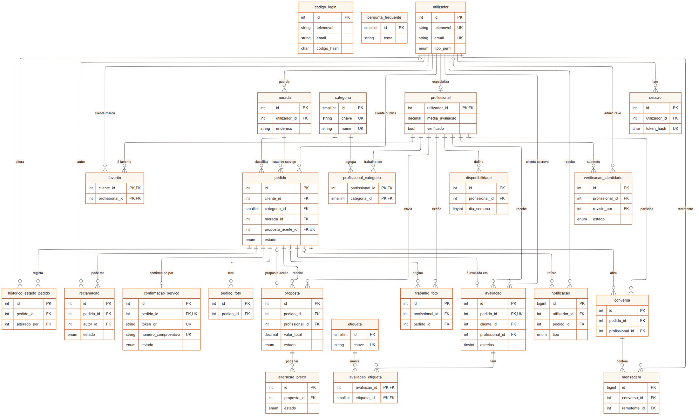

<p align="center"></p>

# Kisalu Express — BD Report

**Base de dados e dados de exemplo da Kisalu Express** · Projeto Multidisciplinar Mobile  ·  2.ª Entrega  ·  g05-bd-report

Versão PDF: [g05-bd-report.pdf](g05-bd-report.pdf) · Relatório intermédio: [g05-relatorio-intermedio.md](g05-relatorio-intermedio.md) · Scripts: [kisalu-api/database](https://github.com/Eng-Infomatica-IADE/kisalu-api/tree/main/database)

---

## 1. Identificação

|   |   |
|---|---|
| **Universidade** | Universidade Europeia |
| **Faculdade** | IADE – Faculdade de Design, Tecnologia e Comunicação |
| **Curso / UC** | Licenciatura em Engenharia Informática · Bases de Dados / Projeto de Desenvolvimento Móvel |
| **Grupo** | Grupo 05 · Turma D02 |
| **Elementos** | Álvaro da Silva – 20252049<br>Adilson Yango – 20252312<br>Milton Malavo – 20252099 |
| **Projeto** | Kisalu Express |
| **Scripts SQL** | [database/create.sql](https://github.com/Eng-Infomatica-IADE/kisalu-api/blob/main/database/create.sql)<br>[database/populate.sql](https://github.com/Eng-Infomatica-IADE/kisalu-api/blob/main/database/populate.sql)<br>[database/queries.sql](https://github.com/Eng-Infomatica-IADE/kisalu-api/blob/main/database/queries.sql) |
| **Repositórios** | [https://github.com/Eng-Infomatica-IADE/Kisalu-Express](https://github.com/Eng-Infomatica-IADE/Kisalu-Express)<br>[https://github.com/Eng-Infomatica-IADE/kisalu-api](https://github.com/Eng-Infomatica-IADE/kisalu-api) |
| **Data** | 6 de novembro de 2026 |

## 2. Objetivo da base de dados

A base `kisalu_express` guarda tudo o que a app precisa para ligar clientes a profissionais: contas, perfis, pedidos, propostas, a confirmação do serviço por QR, avaliações, reclamações e conversas. É também onde ficam as regras que não podem falhar mesmo que a API tenha um erro: uma avaliação por serviço, só de serviços confirmados, reclamações dentro da garantia de 7 dias, e o pedido só fica concluído quando a confirmação é registada.

É criada por três scripts no repositório `kisalu-api/database`: `create.sql` (25 tabelas, índices, 5 triggers e 3 vistas), `populate.sql` (dados de exemplo) e `queries.sql` (consultas comentadas por ecrã). MySQL 8.0+ ou MariaDB 10.6+, motor InnoDB, `utf8mb4`, datas em UTC e valores em kwanzas `DECIMAL(12,2)`. `npm run db:reset` apaga e recria a base; com Docker, o contentor do MySQL corre os dois primeiros scripts no primeiro arranque.

## 3. Decisões de modelação

- **Uma conta por telemóvel.** `utilizador.telemovel` é único e identifica a pessoa; o email é opcional. Não há palavra-passe: `codigo_login` guarda o hash SHA-256 dos códigos SMS ou email, com validade e tentativas.

- **Profissional como especialização.** `profissional` é 1:1 com `utilizador` (a PK é também FK). A mesma pessoa pode ser cliente e profissional; o modo em uso fica em `sessao.perfil_ativo`.

- **O pedido no centro.** Tudo o que acontece depois (propostas, confirmação, avaliação, reclamações, conversas, fotos do portefólio) aponta para `pedido`.

- **Duas relações pedido–proposta.** 1:N para as propostas recebidas e 0..1 para a aceite (`pedido.proposta_aceite_id`, UNIQUE). A segunda FK é criada com `ALTER TABLE` depois de `proposta`, para evitar a dependência circular.

- **Preço por componentes.** Mão de obra, material e deslocação ficam separados; `valor_total` é uma coluna gerada, por isso nunca discorda da soma.

- **O acordo fica congelado.** `confirmacao_servico.valor_acordado` guarda o valor aceite (ou a alteração aprovada). O comprovativo não muda se a proposta for editada depois.

- **Privacidade (RGPD, RNF10).** O consentimento fica em `utilizador.consentimento_rgpd_em`; desativar a conta põe `ativo = FALSE`. A morada exata só é devolvida pela API ao profissional da proposta aceite. Os ficheiros de identidade ficam fora da pasta pública.

- **Enumerações em ENUM.** Estados de pedido, proposta, confirmação, verificação e reclamação são `ENUM`, o que impede valores fora da lista sem precisar de tabelas de domínio.

## 4. Normalização

O esquema está na **3.ª forma normal**: cada tabela descreve uma só entidade ou relação, os atributos dependem só da chave e as relações N:M têm tabela própria (`profissional_categoria`, `avaliacao_etiqueta`, `favorito`). Há quatro desnormalizações escolhidas, todas controladas:

| Onde | Porquê e como se mantém coerente |
|---|---|
| `profissional.media_avaliacao`, `total_avaliacoes`, `total_servicos` | O perfil e a pesquisa mostram estes números em todas as listas. São atualizados por triggers, sem cálculo na leitura. |
| `profissional.avaliacoes_1` … `avaliacoes_5` | Distribuição das estrelas, com o histórico anterior aos dados de exemplo. Base da estatística (Matemática Discreta); o trigger soma 1 à coluna certa e recalcula total e média. |
| `proposta.valor_total` | Coluna gerada (STORED) a partir dos três componentes; o MySQL não deixa escrever nela. |
| `confirmacao_servico.valor_acordado` | Fotografia do acordo no momento da aceitação; é o valor do comprovativo. |
| `profissional.especialidades` (JSON) | Lista de texto livre só para mostrar no perfil; não é pesquisada nem tem integridade a garantir. |

## 5. Modelo entidade-relação

O diagrama mostra as 25 tabelas com as chaves (PK, FK, UK) e as cardinalidades em notação pé-de-galinha. `codigo_login` e `pergunta_frequente` não têm chaves estrangeiras: o código liga-se à conta pelo telemóvel ou email.



*Figura 1 – Modelo ER da base kisalu_express.*

## 6. Tabelas por área

| Área | Tabelas | Papel |
|---|---|---|
| **Contas e autenticação** | `utilizador`, `codigo_login`, `sessao` | conta de qualquer pessoa na plataforma (cliente, profissional ou admin); códigos de 6 dígitos enviados por SMS ou email; sessão mantida no dispositivo (RF01) |
| **Profissionais, categorias e verificação** | `categoria`, `profissional`, `profissional_categoria`, `verificacao_identidade`, `disponibilidade` | tipos de serviço (Eletricista, Canalizador…); especialização 1:1 de `utilizador`, só para quem trabalha como profissional; relação N:M entre profissionais e categorias; pedido de verificação com documento e fotografia do rosto (RF07); horário semanal do profissional (RF15) |
| **Moradas e favoritos** | `morada`, `favorito` | moradas guardadas pelo utilizador (RM05); profissionais favoritos de um cliente (RF13) |
| **Pedidos e propostas** | `pedido`, `pedido_foto`, `historico_estado_pedido`, `proposta`, `alteracao_preco` | pedido de serviço publicado por um cliente (RF03, RF05, RF08); fotos opcionais do pedido (RF03, RM04); linha do tempo do pedido (RF08); proposta de um profissional com preço fechado em Kz (RF04, RF15); alteração do preço combinado; só vale com aprovação do cliente (RF08) |
| **Confirmação por QR e pagamento** | `confirmacao_servico` | confirmação do serviço por QR ou código numérico, com comprovativo (RF10, RF14) |
| **Reclamações** | `reclamacao` | reclamação ao abrigo da garantia de 7 dias (RF11) |
| **Avaliações e portefólio** | `avaliacao`, `etiqueta`, `avaliacao_etiqueta`, `trabalho_foto` | avaliação do cliente ao profissional, uma por serviço (RF12); etiquetas rápidas do ecrã 06: pontual, preco_justo, simpatico, trabalho_limpo, rapido; relação N:M entre avaliações e etiquetas; galeria "Trabalhos feitos" do profissional (RF06) |
| **Conversas e notificações** | `conversa`, `mensagem`, `notificacao` | conversa entre o cliente (via pedido) e um profissional, uma por par pedido-profissional (RF09); mensagem de texto e/ou foto numa conversa; notificações para o utilizador (RM06) |
| **Ajuda** | `pergunta_frequente` | perguntas frequentes (RF16) |

## 7. Chaves e restrições

### 7.1 Chaves

- **Primárias:** inteiros `AUTO_INCREMENT` sem sinal; `BIGINT` em `mensagem` e `notificacao`, que crescem mais. As tabelas de associação usam PK composta (`profissional_categoria`, `avaliacao_etiqueta`, `favorito`) e `profissional` usa a PK de `utilizador`.

- **Únicas:** `utilizador.telemovel` e `email`; `sessao.token_hash`; `categoria.chave` e `nome`; `proposta (pedido_id, profissional_id)`; `pedido.proposta_aceite_id`; `confirmacao_servico.pedido_id`, `token_qr` e `numero_comprovativo`; `avaliacao.pedido_id`; `conversa (pedido_id, profissional_id)`.

- **Estrangeiras:** `CASCADE` quando o filho não faz sentido sem o pai (fotos, propostas, mensagens, sessões); `RESTRICT` para não perder histórico (cliente e categoria de um pedido, autor de reclamação, profissional de uma proposta); `SET NULL` quando a ligação é opcional (admin que reviu, proposta aceite, pedido de origem de uma foto do portefólio).

### 7.2 Restrições CHECK

| Tabela | Regra |
|---|---|
| `codigo_login` | Tem de ter email ou telemóvel. |
| `verificacao_identidade` | Fora de `rascunho`, tem de ter documento e fotografia do rosto. |
| `disponibilidade` | `dia_semana` entre 1 e 7; `hora_fim > hora_inicio`. |
| `pedido` | Se a urgência for `agendado`, `data_pretendida` é obrigatória. |
| `proposta` | Valores ≥ 0; ou chega à hora pedida, ou indica `tempo_chegada_min`. |
| `alteracao_preco` | `valor_novo` ≥ 0. |
| `confirmacao_servico` | `codigo_numerico` com exatamente 6 dígitos. |
| `avaliacao` | `estrelas` entre 1 e 5. |
| `mensagem` | Tem texto ou foto. |

### 7.3 Índices

Além das PK, UNIQUE e FK: `pedido (estado, categoria_id)` e `(cliente_id, estado)` para as listas de pedidos; `mensagem (conversa_id, enviada_em)`; `notificacao (utilizador_id, lida, criado_em)` para o sino; `codigo_login (telemovel, criado_em)` e `(email, criado_em)` para o limite de pedidos de código.

## 8. Triggers e vistas

| Trigger | Quando | O que faz |
|---|---|---|
| `trg_pedido_historico` | AFTER UPDATE pedido | Se o estado mudou, regista estado anterior e novo em `historico_estado_pedido` (RF08). |
| `trg_avaliacao_valida` | BEFORE INSERT avaliacao | Recusa (SQLSTATE 45000) se o pedido não estiver concluído ou se quem avalia não for o cliente do pedido (RF12). |
| `trg_avaliacao_media` | AFTER INSERT avaliacao | Soma 1 a `avaliacoes_<estrelas>` e recalcula `total_avaliacoes` e `media_avaliacao` (Σ k·nₖ / total) a partir da distribuição. |
| `trg_reclamacao_garantia` | BEFORE INSERT reclamacao | Recusa antes de haver proposta aceite e depois de 7 dias da conclusão (RF11). |
| `trg_confirmacao_concluir` | AFTER UPDATE confirmacao_servico | Ao passar a `confirmado`: pedido `concluido`, `concluido_em` e +1 serviço ao profissional (RF10). |

| Vista | O que devolve |
|---|---|
| `vw_cartao_proposta` | O cartão que o cliente compara (RF04): valor total, o que inclui, chegada, estrelas, n.º de serviços e selo, juntando proposta, profissional e utilizador. |
| `vw_media_categoria` | Por categoria: número de avaliações, soma das estrelas e média. É o prior C da média bayesiana que ordena a pesquisa. |
| `vw_comprovativo` | O comprovativo digital (RF10) das confirmações concluídas: número, pedido, cliente, profissional, valor, pagamento e data. |

## 9. Dicionário de dados

Todas as tabelas em InnoDB. Colunas: Tipo · Nulo · Chave (PK, FK com a ação ON DELETE, UQ) · Omissão · Descrição.

### 2.1 Contas e autenticação

#### utilizador

Conta de qualquer pessoa na plataforma (cliente, profissional ou admin). Nasce do telemóvel ou do email; quem entra por SMS ainda não tem nome nem email.

| Coluna | Tipo | Nulo | Chave | Omissão | Descrição |
|---|---|---|---|---|---|
| id | INT UNSIGNED AUTO_INCREMENT | não | PK |  | Identificador |
| email | VARCHAR(150) | sim | UQ |  | Entrada alternativa por email |
| telemovel | VARCHAR(20) | não | UQ |  | Identifica a conta, ex.: +244923456789 |
| nome | VARCHAR(100) | sim |  |  | Preenchido no registo |
| foto_url | VARCHAR(255) | sim |  |  | Fotografia de perfil |
| tipo_perfil | ENUM('cliente', 'profissional', 'admin') | não |  | 'cliente' | Tipo de conta |
| consentimento_rgpd_em | DATETIME | sim |  |  | Momento do consentimento (RNF10) |
| ativo | BOOLEAN | não |  | TRUE | Conta ativa (a desativação respeita o RGPD) |
| criado_em | DATETIME | não |  | CURRENT_TIMESTAMP | Criação da conta |
| ultimo_acesso_em | DATETIME | sim |  |  | Último acesso |

#### codigo_login

Códigos de 6 dígitos enviados por SMS ou email. Guarda-se apenas o hash.

| Coluna | Tipo | Nulo | Chave | Omissão | Descrição |
|---|---|---|---|---|---|
| id | INT UNSIGNED AUTO_INCREMENT | não | PK |  | Identificador |
| email | VARCHAR(150) | sim |  |  | Destino, se o código foi por email |
| telemovel | VARCHAR(20) | sim |  |  | Destino, se o código foi por SMS |
| codigo_hash | CHAR(64) | não |  |  | SHA-256 do código, nunca o código em claro |
| expira_em | DATETIME | não |  |  | Fim da validade |
| tentativas | TINYINT UNSIGNED | não |  | 0 | Tentativas erradas |
| usado | BOOLEAN | não |  | FALSE | Já foi consumido |
| criado_em | DATETIME | não |  | CURRENT_TIMESTAMP | Envio |

Regra: `CHECK (email IS NOT NULL OR telemovel IS NOT NULL)`. Índices em (email, criado_em) e (telemovel, criado_em).

#### sessao

Sessão mantida no dispositivo (RF01). `perfil_ativo` permite à mesma pessoa usar a app como cliente ou como profissional.

| Coluna | Tipo | Nulo | Chave | Omissão | Descrição |
|---|---|---|---|---|---|
| id | INT UNSIGNED AUTO_INCREMENT | não | PK |  | Identificador |
| utilizador_id | INT UNSIGNED | não | FK → utilizador(id), CASCADE |  | Dono da sessão |
| token_hash | CHAR(64) | não | UQ |  | Hash do token |
| perfil_ativo | ENUM('cliente', 'profissional', 'admin') | sim |  |  | Perfil em uso |
| dispositivo | VARCHAR(100) | sim |  |  | Descrição do dispositivo |
| push_token | VARCHAR(255) | sim |  |  | Token de notificações push (RM06) |
| criado_em | DATETIME | não |  | CURRENT_TIMESTAMP | Início |
| expira_em | DATETIME | não |  |  | Fim da validade |
| revogada | BOOLEAN | não |  | FALSE | Terminada pelo utilizador |

### 2.2 Profissionais, categorias e verificação

#### categoria

Tipos de serviço (Eletricista, Canalizador…). A app identifica-os pela `chave`.

| Coluna | Tipo | Nulo | Chave | Omissão | Descrição |
|---|---|---|---|---|---|
| id | SMALLINT UNSIGNED AUTO_INCREMENT | não | PK |  | Identificador |
| chave | VARCHAR(30) | não | UQ |  | Chave usada pela app (canalizador, ar_cond…) |
| nome | VARCHAR(60) | não | UQ |  | Nome da categoria |
| plural | VARCHAR(60) | não |  |  | Forma plural, para frases como "Já avisámos 8 canalizadores" |
| icone | VARCHAR(60) | não |  |  | Ícone (RNF04: ícone e rótulo) |
| ordem | SMALLINT UNSIGNED | não |  | 0 | Ordem de apresentação |
| em_destaque | BOOLEAN | não |  | FALSE | Aparece na grelha 4 × 2 do Início |
| ativa | BOOLEAN | não |  | TRUE | Disponível para novos pedidos |

#### profissional

Especialização 1:1 de `utilizador`, só para quem trabalha como profissional.

| Coluna | Tipo | Nulo | Chave | Omissão | Descrição |
|---|---|---|---|---|---|
| utilizador_id | INT UNSIGNED | não | PK, FK → utilizador(id), CASCADE |  | Conta do profissional |
| bio | VARCHAR(500) | sim |  |  | Apresentação |
| anos_experiencia | TINYINT UNSIGNED | sim |  |  | Anos de experiência |
| zona | VARCHAR(80) | sim |  |  | Zona mostrada, ex.: "Talatona, Luanda" |
| raio_atuacao_km | SMALLINT UNSIGNED | não |  | 10 | Raio de atuação |
| latitude | DECIMAL(9,6) | sim |  |  | Zona base (não a morada exata) |
| longitude | DECIMAL(9,6) | sim |  |  | Zona base |
| mao_obra_desde | DECIMAL(12,2) | sim |  |  | "Mão de obra desde 8 000 Kz" |
| especialidades | JSON | sim |  |  | Lista de texto, ex.: ["Fugas de água"] |
| disponivel | BOOLEAN | não |  | TRUE | Disponível para trabalhar |
| verificado | BOOLEAN | não |  | FALSE | Selo "Verificado" (RF07) |
| verificado_em | DATETIME | sim |  |  | Quando recebeu o selo |
| media_avaliacao | DECIMAL(2,1) | não |  | 0.0 | Média de estrelas (atualizada por trigger) |
| total_avaliacoes | INT UNSIGNED | não |  | 0 | Número de avaliações (soma de `avaliacoes_1..5`) |
| avaliacoes_1 … avaliacoes_5 | INT UNSIGNED | não |  | 0 | Distribuição: número de avaliações com 1, 2, 3, 4 e 5 estrelas (inclui o histórico; base da estatística do ecrã 03, ver `MATEMATICA.md`) |
| total_servicos | INT UNSIGNED | não |  | 0 | Serviços confirmados por QR |

#### profissional_categoria

Relação N:M entre profissionais e categorias.

| Coluna | Tipo | Nulo | Chave | Omissão | Descrição |
|---|---|---|---|---|---|
| profissional_id | INT UNSIGNED | não | PK, FK → profissional(utilizador_id), CASCADE |  | Profissional |
| categoria_id | SMALLINT UNSIGNED | não | PK, FK → categoria(id), RESTRICT |  | Categoria |

#### verificacao_identidade

Pedido de verificação com documento e fotografia do rosto (RF07). Em `rascunho` os ficheiros ainda estão a ser juntados.

| Coluna | Tipo | Nulo | Chave | Omissão | Descrição |
|---|---|---|---|---|---|
| id | INT UNSIGNED AUTO_INCREMENT | não | PK |  | Identificador |
| profissional_id | INT UNSIGNED | não | FK → profissional(utilizador_id), CASCADE |  | Quem pede |
| tipo_documento | ENUM('bilhete_identidade', 'passaporte', 'cartao_residente') | sim |  |  | Tipo de documento |
| numero_documento | VARCHAR(30) | sim |  |  | Número do documento |
| documento_url | VARCHAR(255) | sim |  |  | Foto do documento |
| selfie_url | VARCHAR(255) | sim |  |  | Foto do rosto |
| estado | ENUM('rascunho', 'pendente', 'aprovada', 'rejeitada') | não |  | 'pendente' | Estado da análise |
| motivo_rejeicao | VARCHAR(255) | sim |  |  | Razão da rejeição |
| revisto_por | INT UNSIGNED | sim | FK → utilizador(id), SET NULL |  | Admin que reviu |
| criado_em | DATETIME | não |  | CURRENT_TIMESTAMP | Criação |
| submetido_em | DATETIME | sim |  |  | Quando foi enviada para análise |
| revisto_em | DATETIME | sim |  |  | Quando foi revista |

Regra: `CHECK (estado = 'rascunho' OR (documento_url IS NOT NULL AND selfie_url IS NOT NULL))`.

#### disponibilidade

Horário semanal do profissional (RF15).

| Coluna | Tipo | Nulo | Chave | Omissão | Descrição |
|---|---|---|---|---|---|
| id | INT UNSIGNED AUTO_INCREMENT | não | PK |  | Identificador |
| profissional_id | INT UNSIGNED | não | FK → profissional(utilizador_id), CASCADE |  | Profissional |
| dia_semana | TINYINT UNSIGNED | não |  |  | 1 = segunda … 7 = domingo |
| hora_inicio | TIME | não |  |  | Início |
| hora_fim | TIME | não |  |  | Fim |

Regras: `dia_semana BETWEEN 1 AND 7`; `hora_fim > hora_inicio`.

### 2.3 Moradas e favoritos

#### morada

Moradas guardadas pelo utilizador (RM05).

| Coluna | Tipo | Nulo | Chave | Omissão | Descrição |
|---|---|---|---|---|---|
| id | INT UNSIGNED AUTO_INCREMENT | não | PK |  | Identificador |
| utilizador_id | INT UNSIGNED | não | FK → utilizador(id), CASCADE |  | Dono |
| rotulo | VARCHAR(40) | não |  | 'Casa' | Casa, Trabalho… |
| endereco | VARCHAR(200) | não |  |  | Endereço |
| ponto_referencia | VARCHAR(200) | sim |  |  | Ex.: "perto da cantina…" |
| bairro | VARCHAR(80) | sim |  |  | Bairro |
| municipio | VARCHAR(80) | não |  |  | Município |
| provincia | VARCHAR(60) | não |  | 'Luanda' | Província |
| latitude | DECIMAL(9,6) | sim |  |  | GPS |
| longitude | DECIMAL(9,6) | sim |  |  | GPS |
| predefinida | BOOLEAN | não |  | FALSE | Morada por omissão |
| criado_em | DATETIME | não |  | CURRENT_TIMESTAMP | Criação |

#### favorito

Profissionais favoritos de um cliente (RF13).

| Coluna | Tipo | Nulo | Chave | Omissão | Descrição |
|---|---|---|---|---|---|
| cliente_id | INT UNSIGNED | não | PK, FK → utilizador(id), CASCADE |  | Cliente |
| profissional_id | INT UNSIGNED | não | PK, FK → profissional(utilizador_id), CASCADE |  | Profissional favorito |
| criado_em | DATETIME | não |  | CURRENT_TIMESTAMP | Quando foi marcado |

### 2.4 Pedidos e propostas

#### pedido

Pedido de serviço publicado por um cliente (RF03, RF05, RF08).

| Coluna | Tipo | Nulo | Chave | Omissão | Descrição |
|---|---|---|---|---|---|
| id | INT UNSIGNED AUTO_INCREMENT | não | PK |  | Identificador |
| cliente_id | INT UNSIGNED | não | FK → utilizador(id), RESTRICT |  | Quem pede |
| categoria_id | SMALLINT UNSIGNED | não | FK → categoria(id), RESTRICT |  | Tipo de serviço |
| morada_id | INT UNSIGNED | não | FK → morada(id), RESTRICT |  | Local do serviço |
| titulo | VARCHAR(100) | não |  |  | Ex.: "Fuga de água na cozinha" |
| descricao | TEXT | não |  |  | Descrição do problema |
| urgencia | ENUM('o_mais_cedo_possivel', 'agendado') | não |  | 'o_mais_cedo_possivel' | Urgência |
| data_pretendida | DATETIME | sim |  |  | Obrigatória se agendado |
| estado | ENUM('rascunho', 'publicado', 'com_propostas', 'aceite', 'a_caminho', 'em_curso', 'concluido', 'cancelado') | não |  | 'rascunho' | Estado do pedido (RF08) |
| proposta_aceite_id | INT UNSIGNED | sim | UQ, FK → proposta(id), SET NULL |  | Proposta aceite |
| motivo_cancelamento | VARCHAR(255) | sim |  |  | Razão do cancelamento |
| criado_em | DATETIME | não |  | CURRENT_TIMESTAMP | Criação |
| publicado_em | DATETIME | sim |  |  | Publicação |
| concluido_em | DATETIME | sim |  |  | Conclusão; conta a garantia de 7 dias (RF11) |
| cancelado_em | DATETIME | sim |  |  | Cancelamento |
| atualizado_em | DATETIME | não |  | CURRENT_TIMESTAMP ON UPDATE CURRENT_TIMESTAMP | Última alteração |

Regra: `CHECK (urgencia = 'o_mais_cedo_possivel' OR data_pretendida IS NOT NULL)`. Índices em (estado, categoria_id) e (cliente_id, estado).

#### pedido_foto

Fotos opcionais do pedido (RF03, RM04).

| Coluna | Tipo | Nulo | Chave | Omissão | Descrição |
|---|---|---|---|---|---|
| id | INT UNSIGNED AUTO_INCREMENT | não | PK |  | Identificador |
| pedido_id | INT UNSIGNED | não | FK → pedido(id), CASCADE |  | Pedido |
| url | VARCHAR(255) | não |  |  | Ficheiro |
| criado_em | DATETIME | não |  | CURRENT_TIMESTAMP | Criação |

#### historico_estado_pedido

Linha do tempo do pedido (RF08). É preenchida pelo trigger `trg_pedido_historico`.

| Coluna | Tipo | Nulo | Chave | Omissão | Descrição |
|---|---|---|---|---|---|
| id | INT UNSIGNED AUTO_INCREMENT | não | PK |  | Identificador |
| pedido_id | INT UNSIGNED | não | FK → pedido(id), CASCADE |  | Pedido |
| estado_anterior | VARCHAR(20) | sim |  |  | Estado antes da mudança |
| estado_novo | VARCHAR(20) | não |  |  | Estado depois da mudança |
| alterado_por | INT UNSIGNED | sim | FK → utilizador(id), SET NULL |  | Quem alterou |
| criado_em | DATETIME | não |  | CURRENT_TIMESTAMP | Momento |

#### proposta

Proposta de um profissional com preço fechado em Kz (RF04, RF15).

| Coluna | Tipo | Nulo | Chave | Omissão | Descrição |
|---|---|---|---|---|---|
| id | INT UNSIGNED AUTO_INCREMENT | não | PK |  | Identificador |
| pedido_id | INT UNSIGNED | não | FK → pedido(id), CASCADE; UQ (pedido_id, profissional_id) |  | Pedido |
| profissional_id | INT UNSIGNED | não | FK → profissional(utilizador_id), RESTRICT; UQ com pedido_id |  | Quem propõe |
| valor_mao_obra | DECIMAL(12,2) | não |  | 0 | Mão de obra |
| valor_material | DECIMAL(12,2) | não |  | 0 | Material |
| valor_deslocacao | DECIMAL(12,2) | não |  | 0 | Deslocação |
| valor_total | DECIMAL(12,2) | não |  | coluna gerada (STORED) | Soma dos três valores |
| inclui_descricao | VARCHAR(300) | sim |  |  | Ex.: "Mão de obra · material · deslocação" |
| material_detalhe | VARCHAR(150) | sim |  |  | Ex.: "sifão e vedante" |
| tempo_chegada_min | SMALLINT UNSIGNED | sim |  |  | Chega daqui a N minutos |
| na_hora_pedida | BOOLEAN | não |  | FALSE | Chega à hora que o cliente pediu |
| mensagem | VARCHAR(500) | sim |  |  | Mensagem ao cliente |
| estado | ENUM('enviada', 'aceite', 'recusada', 'retirada', 'expirada') | não |  | 'enviada' | Estado |
| criado_em | DATETIME | não |  | CURRENT_TIMESTAMP | Envio |
| respondida_em | DATETIME | sim |  |  | Resposta do cliente |

Regras: valores >= 0; `na_hora_pedida = TRUE OR tempo_chegada_min IS NOT NULL`.

#### alteracao_preco

Alteração do preço combinado; só vale com aprovação do cliente (RF08).

| Coluna | Tipo | Nulo | Chave | Omissão | Descrição |
|---|---|---|---|---|---|
| id | INT UNSIGNED AUTO_INCREMENT | não | PK |  | Identificador |
| proposta_id | INT UNSIGNED | não | FK → proposta(id), CASCADE |  | Proposta alterada |
| valor_anterior | DECIMAL(12,2) | não |  |  | Valor antes |
| valor_novo | DECIMAL(12,2) | não |  |  | Valor pedido (>= 0) |
| motivo | VARCHAR(300) | não |  |  | Justificação |
| estado | ENUM('pendente', 'aprovada', 'recusada') | não |  | 'pendente' | Decisão do cliente |
| pedida_em | DATETIME | não |  | CURRENT_TIMESTAMP | Pedido |
| respondida_em | DATETIME | sim |  |  | Resposta |

### 2.5 Confirmação por QR e pagamento

#### confirmacao_servico

Confirmação do serviço por QR ou código numérico, com comprovativo (RF10, RF14). O token do QR é opaco. O código numérico aceita no máximo 5 tentativas erradas.

| Coluna | Tipo | Nulo | Chave | Omissão | Descrição |
|---|---|---|---|---|---|
| id | INT UNSIGNED AUTO_INCREMENT | não | PK |  | Identificador |
| pedido_id | INT UNSIGNED | não | FK → pedido(id), CASCADE; UQ |  | Pedido (1:1) |
| token_qr | VARCHAR(64) | não | UQ |  | Texto opaco do QR |
| codigo_numerico | CHAR(6) | não |  |  | Alternativa ao QR |
| valor_acordado | DECIMAL(12,2) | não |  |  | Valor aceite (ou alteração aprovada) |
| estado | ENUM('pendente', 'confirmado', 'expirado') | não |  | 'pendente' | Estado |
| tentativas | TINYINT UNSIGNED | não |  | 0 | Tentativas erradas do código |
| expira_em | DATETIME | sim |  |  | Validade do QR |
| qr_aberto_em | DATETIME(3) | sim |  |  | Última vez que o cliente abriu ou renovou o QR; desempata códigos iguais em `POST /pedidos/confirmar` |
| metodo_confirmacao | ENUM('qr', 'codigo') | sim |  |  | Como foi confirmado |
| metodo_pagamento | ENUM('dinheiro', 'multicaixa_express', 'transferencia') | sim |  |  | Forma de pagamento (RF14) |
| numero_comprovativo | VARCHAR(20) | sim | UQ |  | Ex.: KX-2026-000123 |
| gerado_em | DATETIME | não |  | CURRENT_TIMESTAMP | Geração |
| confirmado_em | DATETIME | sim |  |  | Confirmação |

Regra: `codigo_numerico REGEXP '^[0-9]{6}$'`.

### 2.6 Reclamações

#### reclamacao

Reclamação ao abrigo da garantia de 7 dias (RF11).

| Coluna | Tipo | Nulo | Chave | Omissão | Descrição |
|---|---|---|---|---|---|
| id | INT UNSIGNED AUTO_INCREMENT | não | PK |  | Identificador |
| pedido_id | INT UNSIGNED | não | FK → pedido(id), CASCADE |  | Pedido |
| autor_id | INT UNSIGNED | não | FK → utilizador(id), RESTRICT |  | Quem reclama |
| tipo | ENUM('trabalho_mal_feito', 'preco_diferente', 'nao_compareceu', 'atraso', 'comportamento', 'outro') | não |  |  | Tipo de problema |
| descricao | TEXT | não |  |  | Descrição |
| foto_url | VARCHAR(255) | sim |  |  | Foto de prova |
| estado | ENUM('aberta', 'em_analise', 'resolvida', 'rejeitada') | não |  | 'aberta' | Estado |
| resolucao | VARCHAR(500) | sim |  |  | Decisão final |
| criado_em | DATETIME | não |  | CURRENT_TIMESTAMP | Abertura |
| resolvida_em | DATETIME | sim |  |  | Fecho |

### 2.7 Avaliações e portefólio

#### avaliacao

Avaliação do cliente ao profissional, uma por serviço (RF12).

| Coluna | Tipo | Nulo | Chave | Omissão | Descrição |
|---|---|---|---|---|---|
| id | INT UNSIGNED AUTO_INCREMENT | não | PK |  | Identificador |
| pedido_id | INT UNSIGNED | não | FK → pedido(id), CASCADE; UQ |  | Pedido avaliado |
| cliente_id | INT UNSIGNED | não | FK → utilizador(id), RESTRICT |  | Quem avalia |
| profissional_id | INT UNSIGNED | não | FK → profissional(utilizador_id), CASCADE |  | Avaliado |
| estrelas | TINYINT UNSIGNED | não |  |  | 1 a 5 |
| comentario | VARCHAR(500) | sim |  |  | Texto livre |
| criado_em | DATETIME | não |  | CURRENT_TIMESTAMP | Data |

#### etiqueta

Etiquetas rápidas do ecrã 06: pontual, preco_justo, simpatico, trabalho_limpo, rapido.

| Coluna | Tipo | Nulo | Chave | Omissão | Descrição |
|---|---|---|---|---|---|
| id | SMALLINT UNSIGNED AUTO_INCREMENT | não | PK |  | Identificador |
| chave | VARCHAR(30) | não | UQ |  | Chave enviada pela app |
| nome | VARCHAR(40) | não | UQ |  | Texto mostrado |

#### avaliacao_etiqueta

Relação N:M entre avaliações e etiquetas.

| Coluna | Tipo | Nulo | Chave | Omissão | Descrição |
|---|---|---|---|---|---|
| avaliacao_id | INT UNSIGNED | não | PK, FK → avaliacao(id), CASCADE |  | Avaliação |
| etiqueta_id | SMALLINT UNSIGNED | não | PK, FK → etiqueta(id), CASCADE |  | Etiqueta |

#### trabalho_foto

Galeria "Trabalhos feitos" do profissional (RF06). `pedido_id` liga a um serviço confirmado.

| Coluna | Tipo | Nulo | Chave | Omissão | Descrição |
|---|---|---|---|---|---|
| id | INT UNSIGNED AUTO_INCREMENT | não | PK |  | Identificador |
| profissional_id | INT UNSIGNED | não | FK → profissional(utilizador_id), CASCADE |  | Dono |
| pedido_id | INT UNSIGNED | sim | FK → pedido(id), SET NULL |  | Serviço de origem |
| url | VARCHAR(255) | não |  |  | Ficheiro |
| legenda | VARCHAR(150) | sim |  |  | Legenda |
| visivel | BOOLEAN | não |  | TRUE | Visível no perfil |
| criado_em | DATETIME | não |  | CURRENT_TIMESTAMP | Data |

### 2.8 Conversas e notificações

#### conversa

Conversa entre o cliente (via pedido) e um profissional, uma por par pedido-profissional (RF09).

| Coluna | Tipo | Nulo | Chave | Omissão | Descrição |
|---|---|---|---|---|---|
| id | INT UNSIGNED AUTO_INCREMENT | não | PK |  | Identificador |
| pedido_id | INT UNSIGNED | não | FK → pedido(id), CASCADE; UQ (pedido_id, profissional_id) |  | Pedido |
| profissional_id | INT UNSIGNED | não | FK → profissional(utilizador_id), CASCADE; UQ com pedido_id |  | Profissional |
| criado_em | DATETIME | não |  | CURRENT_TIMESTAMP | Abertura |

#### mensagem

Mensagem de texto e/ou foto numa conversa.

| Coluna | Tipo | Nulo | Chave | Omissão | Descrição |
|---|---|---|---|---|---|
| id | BIGINT UNSIGNED AUTO_INCREMENT | não | PK |  | Identificador |
| conversa_id | INT UNSIGNED | não | FK → conversa(id), CASCADE |  | Conversa |
| remetente_id | INT UNSIGNED | não | FK → utilizador(id), CASCADE |  | Quem enviou |
| texto | TEXT | sim |  |  | Texto |
| foto_url | VARCHAR(255) | sim |  |  | Foto |
| enviada_em | DATETIME | não |  | CURRENT_TIMESTAMP | Envio |
| lida_em | DATETIME | sim |  |  | Leitura |

Regra: `texto IS NOT NULL OR foto_url IS NOT NULL`. Índice em (conversa_id, enviada_em).

#### notificacao

Notificações para o utilizador (RM06).

| Coluna | Tipo | Nulo | Chave | Omissão | Descrição |
|---|---|---|---|---|---|
| id | BIGINT UNSIGNED AUTO_INCREMENT | não | PK |  | Identificador |
| utilizador_id | INT UNSIGNED | não | FK → utilizador(id), CASCADE |  | Destinatário |
| pedido_id | INT UNSIGNED | sim | FK → pedido(id), CASCADE |  | Pedido relacionado |
| tipo | ENUM('novo_pedido', 'nova_proposta', 'proposta_aceite', 'estado_pedido', 'alteracao_preco', 'nova_mensagem', 'lembrete_avaliacao', 'reclamacao', 'sistema') | não |  |  | Tipo |
| titulo | VARCHAR(80) | não |  |  | Título |
| corpo | VARCHAR(200) | não |  |  | Texto |
| acao | VARCHAR(40) | sim |  |  | Ação direta, ex.: "ver_propostas" |
| lida | BOOLEAN | não |  | FALSE | Já lida |
| criado_em | DATETIME | não |  | CURRENT_TIMESTAMP | Criação |

Índice em (utilizador_id, lida, criado_em).

### 2.9 Ajuda

#### pergunta_frequente

Perguntas frequentes (RF16).

| Coluna | Tipo | Nulo | Chave | Omissão | Descrição |
|---|---|---|---|---|---|
| id | SMALLINT UNSIGNED AUTO_INCREMENT | não | PK |  | Identificador |
| tema | VARCHAR(40) | não |  |  | Ex.: "QR Code", "Pagamentos" |
| pergunta | VARCHAR(200) | não |  |  | Pergunta |
| resposta | TEXT | não |  |  | Resposta |
| ordem | SMALLINT UNSIGNED | não |  | 0 | Ordem |
| ativa | BOOLEAN | não |  | TRUE | Visível |

## 10. Guia de Dados

O `populate.sql` cria uma BD de teste coerente com o mock da app: os mesmos nomes, valores e datas aparecem com ou sem servidor. Todos os nomes, telemóveis, emails e documentos são fictícios. As datas do pedido em curso são relativas a `NOW()`, para o cenário estar sempre “fresco” quando se recria a base.

### 10.1 Contagens por tabela

| Área | Tabela | Linhas | Conteúdo |
|---|---|---|---|
| Contas | utilizador | 14 | 6 clientes, 7 profissionais, 1 admin |
|  | codigo_login · sessao | 0 · 0 | Criados ao entrar na app |
| Profissionais | profissional | 7 | 5 verificados, 2 por verificar |
|  | categoria | 13 | 8 em destaque no Início |
|  | profissional_categoria | 9 | Joaquim e Rui: canalizador e pedreiro |
|  | verificacao_identidade | 5 | Todas aprovadas pelo admin |
|  | disponibilidade | 6 | Horário do Joaquim, seg. a sáb. |
| Moradas | morada | 7 | Maria com Casa e Trabalho; 1 por cliente |
|  | favorito | 3 | Favoritos da Maria |
| Pedidos | pedido | 10 | 1 com propostas, 1 publicado, 6 concluídos, 2 cancelados |
|  | pedido_foto | 1 | Foto da fuga (pedido 1) |
|  | historico_estado_pedido | 3 | 2 inseridos + 1 do trigger (publicado → com_propostas) |
| Propostas | proposta | 11 | 3 enviadas (pedido 1) e 8 aceites |
|  | alteracao_preco | 0 | Criada nas consultas e nos testes |
| Confirmação | confirmacao_servico | 8 | 6 confirmadas (KX-2026-…), 2 expiradas |
| Pós-serviço | avaliacao | 5 | 2 ao Joaquim, 3 da Maria a outros |
|  | etiqueta · avaliacao_etiqueta | 5 · 8 | Pontual, Preço justo, Simpático, Trabalho limpo, Rápido |
|  | reclamacao | 0 | Criada no guião 3 e nos testes |
|  | trabalho_foto | 3 | Galeria do Joaquim (2 ligadas a serviços) |
| Comunicação | conversa · mensagem | 3 · 7 | Conversa 1 com 2 mensagens por ler |
|  | notificacao | 2 | Uma para a Maria, uma para o Joaquim |
|  | pergunta_frequente | 3 | QR Code, Garantia, Pagamentos |

No total são **133 linhas** em 21 tabelas; 4 tabelas começam vazias (`codigo_login`, `sessao`, `alteracao_preco`, `reclamacao`) e enchem-se com o uso. Depois das inserções, o script repõe a reputação acumulada dos profissionais com a distribuição por estrelas (Joaquim: 1, 1, 3, 13 e 108 avaliações de 1 a 5 estrelas, média 4,8 em 126; Hélder: 28 avaliações, o caso n < 30 do intervalo de confiança). Os triggers continuam a contar a partir daí.

### 10.2 Pessoas

| Pessoa | Telemóvel | Papel nos testes |
|---|---|---|
| **Maria Kiala** (id 1) | +244 923 000 000 | Cliente principal (persona). Talatona, 2 moradas, 3 favoritos, pedido 1 com 3 propostas e histórico de 4 pedidos. |
| **Joaquim Manuel** (id 2) | +244 923 000 002 | Canalizador e pedreiro verificado, 4,8 ★ em 126, a 1,2 km da Maria; horário semanal e galeria de 3 trabalhos. |
| Rui Santos, Paulo Neto (3, 5) | …003, …005 | Os outros dois canalizadores que respondem ao pedido 1 (Paulo sem selo). |
| Ana Cardoso, Carlos Dias, Nuno Ferreira, Hélder Tavares (6–9) | …006 a …009 | Cabeleireira, eletricista, ar condicionado e mecânico: histórico da Maria e mapa. |
| Maria Sebastião, Pedro Kiluange, Ana Paulo, Rui Bento (10–13) | …010 a …013 | Clientes do Joaquim: histórico do lado profissional e autores das avaliações. |
| **Teresa Mbala** (14) | +244 923 000 014 | Cliente em Viana com o pedido 10 por responder; protagonista da história de `queries.sql`. |
| Administrador (4) | +244 923 000 099 | Aprovou as 5 verificações de identidade; vê reclamações. |

### 10.3 Pedidos e os seus estados

| Id | Pedido | Cliente → Prof. | Estado | Cenário de teste |
|---|---|---|---|---|
| 1 | Fuga de água na cozinha | Maria → (3 propostas) | com_propostas | Caso core: comparar e aceitar (ecrãs 04 e 08); propostas de 12.500, 15.000 e 18.500 Kz; conversa aberta com o Joaquim. |
| 2 | Tomada sem luz | Maria → Carlos | concluido | Histórico e comprovativo KX-2026-000001 (QR, dinheiro); avaliada com 5 ★. |
| 3 | Limpeza de AC | Maria → Nuno | concluido | Confirmação por código; avaliação de 4 ★ com comentário de atraso. |
| 4 | Pastilhas de travão | Maria → Hélder | cancelado | Filtro “Cancelados”; confirmação expirada, sem comprovativo. |
| 5 | Tranças | Maria → Ana C. | concluido | Pagamento por Multicaixa Express. |
| 6–8 | Fuga, desentupir pia, esquentador | Outros clientes → Joaquim | concluido | Histórico do profissional, avaliações e fotos do portefólio ligadas a serviços. |
| 9 | Torneira a pingar | Rui B. → Joaquim | cancelado | Pedido cancelado pelo cliente depois de aceite; aparece no histórico do profissional. |
| 10 | Reparar muro do quintal | Teresa | publicado | Painel do profissional (ecrã 14, “NOVO”) e enviar proposta (15). |

### 10.4 Propostas, confirmações e conversas

- **Propostas:** as 3 do pedido 1 mostram as duas formas de preço (com e sem material) e tempos de chegada diferentes (25, 40 e 60 min). As outras 8 estão aceites e ligadas pelos `proposta_aceite_id`.

- **Confirmações:** 6 confirmadas com os três métodos de pagamento e os dois métodos de confirmação (QR e código); 2 expiradas nos pedidos cancelados.

- **Avaliações:** 5, com 8 etiquetas; permitem testar o perfil (ecrã 03) e a consulta “etiquetas mais dadas”.

- **Conversas:** a conversa 1 (Maria–Joaquim) tem 2 mensagens por ler, para o contador do ecrã 18; as outras duas são de serviços antigos e estão lidas.

- **Notificações:** “Recebeu 3 propostas” para a Maria e “Novo pedido perto de si” para o Joaquim, ambas por ler (ponto vermelho do sino).

### 10.5 Como usar

```bash
npm run db:reset                 # create.sql + populate.sql
npm run db:reset -- --consultas  # o mesmo e corre queries.sql (altera dados)
docker compose up -d --build     # MySQL na porta 3307, já com os dados
```

## 11. Consultas de exemplo (queries.sql)

O `queries.sql` tem as consultas que a API faz, escritas em SQL simples e agrupadas por ecrã. As que alteram dados seguem uma história: a Teresa pede para reparar o muro, o Joaquim envia proposta, ela aceita, ele confirma com o código e ela avalia. Os parâmetros ficam em variáveis (`@maria`, `@joaquim`, `@teresa`). Como pede o briefing, o ficheiro é entregue só como código SQL; aqui descreve-se o que cada grupo responde.

| N.º | Grupo (ecrã) | Pergunta a que responde | Técnicas SQL |
|---|---|---|---|
| 1 | Entrar com o telemóvel (01, 11) | Pode pedir outro código? O código está certo e válido? A conta existe? Que dados mostra o Início? | Agregação condicional, `SHA2`, `TIMESTAMPDIFF`, `EXISTS`, subconsultas escalares, `LEFT JOIN` |
| 2 | Categorias (02, 21) | Quantos profissionais disponíveis há em cada categoria? | `LEFT JOIN` duplo, `COUNT` com `GROUP BY` |
| 3 | Perto de si (02) | Que profissionais estão mais perto da morada predefinida, e a que distância? | Fórmula de Haversine, `SELECT … INTO`, subconsulta correlacionada |
| 4 | Perfil (03) | Dados do profissional, n.º de trabalhos, avaliações com autor abreviado e etiquetas; distribuição das estrelas e média da categoria | `GROUP_CONCAT`, `SUBSTRING_INDEX`, junção com a vista agregada `vw_media_categoria` |
| 5–6 | Painel do profissional (14) | Que pedidos abertos das minhas categorias estão dentro do meu raio, e quais são novos? | Haversine com `HAVING`, `NOT EXISTS`, junção com N:M |
| 7 | Enviar proposta (15, 04) | Inserir proposta; cartões para comparar; hora prevista de chegada | Coluna gerada, `LAST_INSERT_ID`, vista, `CASE` |
| 8 | Aceitar (08, 05) | Aceitar uma, recusar as outras, criar QR e conversa de uma vez | `START TRANSACTION … COMMIT`, `INSERT … SELECT`, `INSERT IGNORE` |
| 9 | QR e código (05, 16) | Que trabalho espera o código? Código errado conta tentativa; código certo conclui | `UPDATE` condicional, trigger `trg_confirmacao_concluir` |
| 10 | Comprovativo (17) | Número, valor, pagamento e data do serviço | Vista `vw_comprovativo` |
| 11 | Avaliar (06) | Gravar avaliação e etiquetas; média nova; etiquetas mais dadas | Triggers de validação e média, `INSERT … SELECT … IN`, `GROUP BY … ORDER BY` |
| 12 | Histórico (07) | Pedidos da Maria com profissional e valor; linha do tempo de um pedido | `LEFT JOIN` em cadeia, `COALESCE` |
| 13–14 | Conversas (18, 19) | Última mensagem e não lidas por conversa; últimas 50 mensagens; marcar lidas | Subconsultas correlacionadas, tabela derivada com `LIMIT`, ordenação por `MAX` |
| 15 | Mapa (22) | Posição relativa (x, y) de cada profissional num mapa de 10 km | Projeção equirretangular, tabela derivada com filtro |

Exemplo (grupo 3): distância em km pela fórmula de Haversine, sem extensões espaciais.

```sql
SELECT p.utilizador_id AS id, u.nome,
       ROUND(6371 * 2 * ASIN(SQRT(POWER(SIN(RADIANS(p.latitude - @lat) / 2), 2)
         + COS(RADIANS(@lat)) * COS(RADIANS(p.latitude))
         * POWER(SIN(RADIANS(p.longitude - @lng) / 2), 2))), 1) AS distancia_km
  FROM profissional p JOIN utilizador u ON u.id = p.utilizador_id AND u.ativo = TRUE
 WHERE p.disponivel = TRUE AND p.latitude IS NOT NULL
 ORDER BY distancia_km LIMIT 20;
```

## 12. Próximos passos

- Guardar as horas reais de “A caminho” e “Em curso” para calibrar o Monte Carlo da chegada com dados.

- Reclamação e alteração de preço de exemplo, para os ecrãs de garantia não começarem vazios.

- Procedimento armazenado para a aceitação da proposta (hoje a transação está na API e em `queries.sql`).

- Rever índices com `EXPLAIN` quando houver mais dados de teste.
