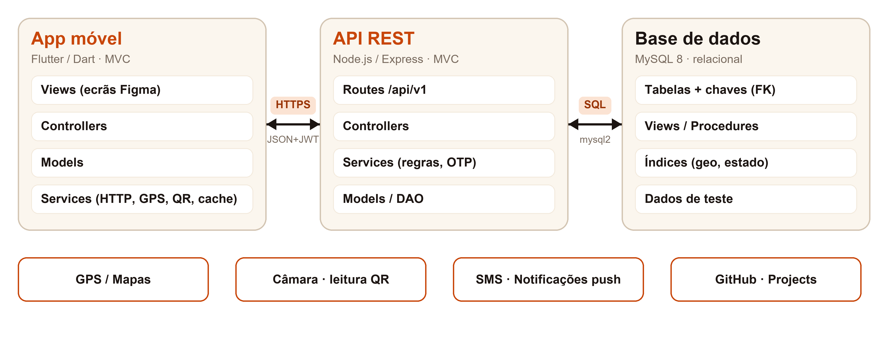
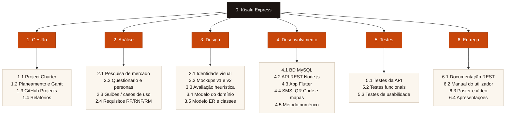
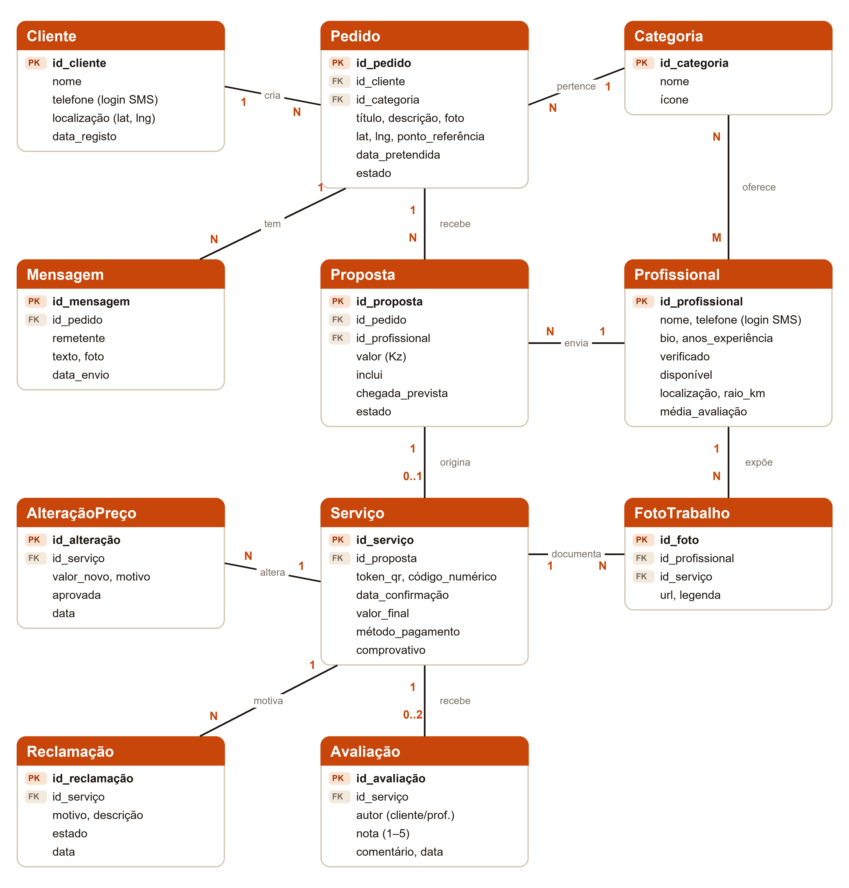
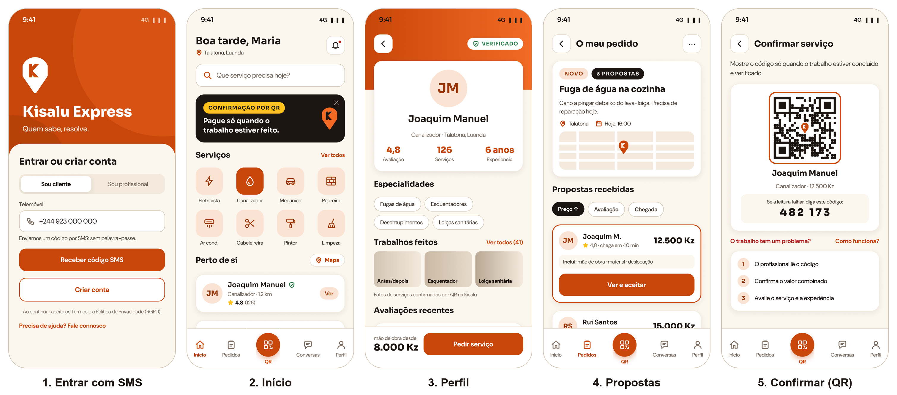
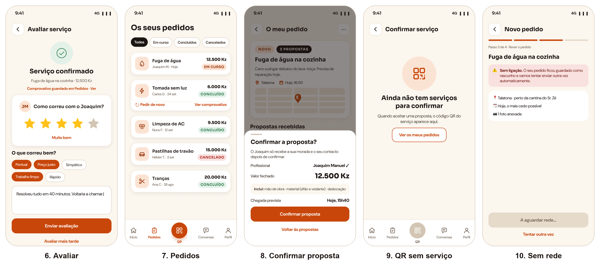
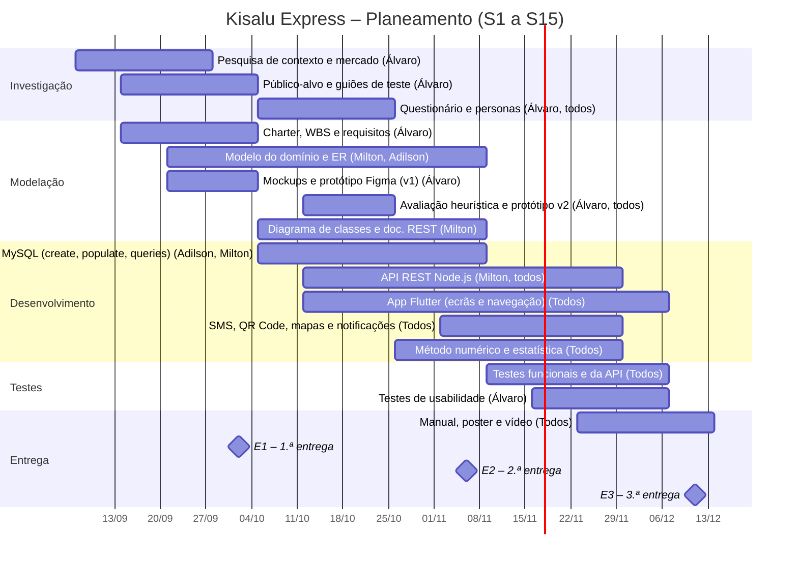

# Kisalu Express — Proposta de Projeto (v2)

**Marketplace móvel de serviços informais em Angola** · Projeto Multidisciplinar Mobile · 2.ª Entrega

Versão PDF: [g05-proposta-v2.pdf](g05-proposta-v2.pdf) · Versão anterior: [g05-proposta-v1.md](g05-proposta-v1.md)

---

## 1. Identificação

|   |   |
|---|---|
| **Universidade** | Universidade Europeia |
| **Faculdade** | IADE – Faculdade de Design, Tecnologia e Comunicação |
| **Curso / UC** | Licenciatura em Engenharia Informática · Projeto de Desenvolvimento Móvel |
| **Grupo** | Grupo 05 · Turma D02 |
| **Elementos** | Álvaro da Silva – 20252049 Adilson Yango – 20252312 Milton Malavo – 20252099 |
| **Projeto** | Kisalu Express |
| **Repositório GitHub** | [https://github.com/Eng-Infomatica-IADE/Kisalu-Express](https://github.com/Eng-Infomatica-IADE/Kisalu-Express) |
| **Figma** | [Kisalu Express — Mockups v2](https://www.figma.com/design/y6x5pO2mwQpoiF5ep18mSl/Kisalu-Express-%E2%80%94-Mockups--G05-?node-id=33-2) |
| **Data** | Novembro de 2026 |

## 2. Palavras-chave

Marketplace de serviços; economia informal; biscateiros; Angola; Flutter; API REST; MySQL; geolocalização; QR Code; código SMS; reputação verificável.

## 3. Descrição da App e problema a resolver

A **Kisalu Express** é uma aplicação móvel que liga clientes a prestadores de serviços informais – os “biscateiros” – como eletricistas, canalizadores, mecânicos, pedreiros, técnicos de ar condicionado ou cabeleireiras. O nome junta “kisalu” (trabalho, em kimbundu) a “express”, traduzindo a promessa da marca: **“Quem sabe, resolve.”**

Em Angola, grande parte destes serviços é contratada por recomendação, grupos de WhatsApp ou na rua. A economia informal representa a maioria do emprego em África (cerca de 85,8 %, segundo a OIT), mas continua quase invisível no digital. Um questionário realizado em outubro de 2026 (8 participantes) mostrou que a recomendação não resolve o problema: 5 em 7 clientes escolheram o profissional por recomendação e todos tiveram pelo menos um problema. As dores mais fortes surgem no fim do serviço: o preço mudou no final em 4 de 7 casos e 5 em 7 tiveram trabalho mal feito, sem garantia nem comprovativo. Abrir a porta a um desconhecido é também uma questão de segurança, referida em todas as respostas sobre o que mais preocupa.

A app resolve estes problemas com **propostas com preço fechado** e o que incluem, **perfis verificados com fotos de trabalhos feitos**, **pesquisa por proximidade**, **confirmação do serviço por QR Code com comprovativo**, **reporte de problemas** e **avaliações de serviços confirmados**.

## 4. Objetivos e motivação

**Motivação.** Os elementos do grupo conhecem de perto a realidade angolana, onde encontrar um profissional de confiança é difícil e onde muitos trabalhadores qualificados não têm forma de chegar a novos clientes. Os participantes do questionário dariam em média 4,4 em 5 a uma app como esta, o que confirma o interesse do lado do cliente.

Objetivos do trabalho:

- Desenvolver uma app Flutter para Android e iOS, com perfis de cliente e de profissional.

- Implementar o ciclo completo pedido → proposta → serviço → confirmação por QR Code → avaliação.

- Garantir que o preço combinado é o preço pago e que o cliente tem resposta quando algo corre mal.

- Disponibilizar pesquisa por categoria e por proximidade.

- Construir uma API REST em Node.js e uma base de dados relacional MySQL, documentadas.

- Atingir os objetivos de experiência definidos: publicar um pedido em 60 s ou menos, ecrãs críticos em WCAG 2.2 AA e SUS de 75 ou mais, com conformidade com o RGPD.

## 5. Público-alvo

| Segmento | Perfil | Necessidade principal |
|---|---|---|
| **Clientes** (persona: Maria Kiala, 29 anos) | Adultos urbanos em Luanda e capitais de província, com smartphone (Android ou iPhone), que usam WhatsApp e Multicaixa Express. | Saber o preço final antes de começar e deixar entrar em casa só quem tem identidade verificada. |
| **Profissionais** (persona: Joaquim Manuel, 41 anos) | Trabalhadores independentes com Android de gama média, dados móveis com saldo controlado e clientes por boca-a-boca. | Trabalho regular e forma de provar a qualidade do que fazem. |

As personas assentam nas respostas ao questionário (n = 8, 8 a 13 de outubro de 2026). A amostra é pequena e urbana, e só um profissional respondeu ao bloco próprio, dando nota 1 em 5 à app. A adesão dos profissionais é por isso o maior risco de produto, a validar nos testes de usabilidade.

## 6. Pesquisa de mercado

Foram analisadas plataformas que resolvem problemas semelhantes, em Angola e noutros mercados. A informação sobre as plataformas angolanas vem dos respetivos sites (consultados a 19/10/2026); as funcionalidades não foram testadas pelo grupo.

| Aplicação | Mercado | Pedido + propostas | Perfis verificados | Confirmação de serviço | Foco no informal |
|---|---|---|---|---|---|
| **TaskRabbit** | EUA, Europa | Não (preço/hora) | Sim | Na app | Não |
| **Thumbtack** | EUA | Sim | Parcial | Não | Não |
| **Fixando** | Portugal | Sim | Parcial | Não | Não |
| **GetNinjas** | Brasil | Sim (pago por lead) | Parcial | Não | Parcial |
| **Bumbaki** | Luanda, Icolo e Bengo | Não (o mais próximo aceita) | Sim (entrevista) | Não | Sim |
| **Conecta Já** | Angola (site) | Pedido de orçamento | Sim (3 níveis) | Pagamento retido | Sim |
| **Grupos WhatsApp / Facebook** | Angola | Informal | Não | Não | Sim |
| **Kisalu Express** | Angola | Sim | Sim | QR Code | Sim |

As plataformas estrangeiras não estão adaptadas ao contexto angolano. Em Angola começam a surgir alternativas, ainda pouco conhecidas: nenhum participante as referiu. O diferencial da Kisalu Express é combinar **várias propostas com preço fechado**, **portefólio ligado a serviços confirmados**, **confirmação presencial por QR Code com comprovativo** e **reporte de problemas**, numa app nativa.

## 7. Guiões de teste (versão preliminar)

### 7.1 Caso core – Pedir um serviço e confirmar por QR Code

**Ator:** Maria (cliente). **Pré-condição:** sessão iniciada e localização ativa.

1. A Maria abre a app e, no ecrã Início, escolhe a categoria **Canalizador**.
2. Toca em **Pedir serviço**, descreve “Fuga de água na cozinha”, adiciona uma foto, confirma a morada e um ponto de referência (Talatona) e a data pretendida.
3. O pedido é publicado e os canalizadores da zona recebem uma notificação.
4. Recebe três propostas, com preço fechado em kwanzas, o que inclui, hora de chegada e avaliação; ordena-as por preço.
5. Abre o perfil do Joaquim Manuel (4,8 ★, verificado), vê as fotos de trabalhos feitos e toca em **Ver e aceitar**.
6. Revê o resumo na folha **Confirmar a proposta?** e confirma (12.500 Kz). Só então o Joaquim recebe a morada e o contacto.
7. O pedido passa a **Em curso**; a Maria recebe notificações com a hora prevista e troca mensagens com o profissional.
8. Concluído o trabalho, a Maria abre **Confirmar serviço** e mostra o QR Code.
9. O Joaquim lê o código com a sua app (ou introduz o código numérico); o serviço fica **Concluído** com o valor combinado e o comprovativo fica guardado no pedido.
10. A app pede à Maria que avalie o serviço, ou que o faça mais tarde.

### 7.2 Caso 2 – Registo e verificação de um profissional

**Ator:** Joaquim (profissional).

1. Instala a app e escolhe **Sou profissional**.
2. Introduz o número de telemóvel e valida-o com o código recebido por SMS.
3. Preenche o perfil: fotografia, categorias (Canalizador), anos de experiência, zona de atuação e raio de deslocação.
4. Carrega o documento de identificação e uma fotografia para obter o selo **Verificado**.
5. Ativa a disponibilidade e passa a receber pedidos da sua zona, aos quais responde com uma proposta por componentes.

### 7.3 Caso 3 – Reportar um problema e pedir de novo

**Ator:** Maria (cliente), após o caso core.

1. Dois dias depois, a fuga volta. A Maria abre o separador **Pedidos** e filtra por **Concluídos**.
2. Seleciona “Fuga de água” e vê o resumo: profissional, valor, data e comprovativo.
3. Toca em **O trabalho tem um problema?**, descreve o que aconteceu e envia o reporte (dentro do prazo de 7 dias).
4. O Joaquim é notificado e combina com a Maria uma nova visita.
5. Resolvido o problema, a Maria toca em **Avaliar**, atribui as estrelas e marca “Pontual” e “Preço justo”; a média do Joaquim é recalculada.
6. Numa próxima avaria, toca em **Pedir de novo** para repetir o serviço com o mesmo profissional.

## 8. Descrição da solução a implementar

### i. Descrição genérica da solução

Sistema cliente-servidor composto por uma **app móvel Flutter** (cliente e profissional na mesma app, com perfis distintos), uma **API REST** em Node.js que concentra a lógica de negócio e uma **base de dados relacional MySQL**. A app usa o GPS para pesquisa por proximidade, a câmara para leitura de QR Code, SMS para autenticação e notificações push para alertar sobre pedidos, propostas e estado do serviço.

### ii. Enquadramento nas Unidades Curriculares

| Unidade Curricular | Contribuição para a Kisalu Express |
|---|---|
| **Projeto de Desenvolvimento Móvel** | Gestão ágil (GitHub Projects), planeamento, documentação, apresentações. |
| **Programação de Dispositivos Móveis** | App Flutter/Dart (MVC), servidor Node.js REST, integração com a BD, Git e documentação REST. |
| **Bases de Dados** | Modelo ER, base de dados MySQL, scripts create/populate/queries e BD exemplo com dados fictícios. |
| **Redes e Comunicação de Dados** | Arquitetura cliente-servidor, HTTPS, autenticação por token e comunicação app–API. |
| **Interfaces e Usabilidade** | Questionário, personas, Journey Map, avaliação heurística, protótipo v2, Mobile App Style Guide, wireframes, Hi-Fi e testes de usabilidade. |
| **Matemática Discreta** | Método de Monte Carlo para estimar o tempo de chegada do profissional; estatística descritiva (média, desvio-padrão) para sugerir intervalos de preço por categoria e calcular a reputação. |

### iii. Requisitos técnicos

- App em **Flutter 3 / Dart**, desenvolvida em Android Studio ou VS Code; alvo Android e iOS.

- Arquitetura **MVC** no frontend e no backend; código separado em módulos (models, views, controllers, services, data access).

- Servidor **Node.js + Express** com API REST em JSON, documentada segundo o formato Bocoup.

- Base de dados **MySQL 8** relacional; dados de desenvolvimento fictícios.

- Permissões do dispositivo: localização (GPS), câmara (QR Code), notificações e acesso a fotografias.

- Comunicação por HTTPS; autenticação com código SMS de uso único e sessão com JWT (sem palavra-passe).

- Funcionamento em rede instável: cache local, compressão de imagens e rascunhos offline.

- Gestão de versões em **GitHub** e de tarefas em **GitHub Projects**; mockups em **Figma**.

### iv. Arquitetura da solução (provisória)

*Figura 1 – Arquitetura cliente-servidor em três camadas.*

### v. Tecnologias a utilizar (provisório)

| Camada | Tecnologias |
|---|---|
| **Mobile** | Flutter, Dart, http/dio, provider, geolocator, google_maps_flutter, mobile_scanner, qr_flutter, firebase_messaging |
| **Backend** | Node.js, Express, mysql2, jsonwebtoken, serviço de envio de SMS (a definir; simulado em desenvolvimento) |
| **Dados** | MySQL 8, MySQL Workbench |
| **Design** | Figma (mockups e protótipo), Mobile App Style Guide, identidade visual Kisalu Express |
| **Gestão** | Git, GitHub, GitHub Projects, Markdown |

### vi. Project Charter

|   |   |
|---|---|
| **Objetivo** | Entregar até 11.12.2026 uma app móvel funcional que ligue clientes a profissionais informais em Angola, com preço fechado e confirmação de serviço por QR Code. |
| **Âmbito (inclui)** | Registo por SMS e perfis; verificação de identidade; pesquisa por categoria e proximidade; pedidos e propostas; mensagens; confirmação por QR Code e comprovativo; reporte de problemas; avaliações; histórico; API REST; BD MySQL; documentação. |
| **Fora de âmbito** | Pagamentos reais integrados e retenção de valores (RF18), versão web, painel de administração completo, publicação nas lojas. |
| **Stakeholders** | Equipa do projeto (G05); docentes das UCs envolvidas; clientes e profissionais (utilizadores finais). |
| **Restrições** | Prazo semestral com três entregas (02.10, 06.11 e 11.12.2026); tecnologias obrigatórias (Flutter, Node.js, MySQL, GitHub, Figma); dados fictícios; RGPD. |
| **Premissas** | Utilizadores com smartphone e acesso a dados móveis; disponibilidade das APIs de mapas e notificações em modo gratuito. |
| **Critérios de sucesso** | Caso core executado de ponta a ponta no telemóvel; todos os RF “Must” implementados; objetivos de experiência atingidos nos testes; entregas dentro do prazo. |
| **Principais riscos** | Baixa adesão dos profissionais (validar nos testes; primeiros pedidos sem custo); pouca evidência do lado do profissional (n = 1); custo do envio de SMS (simular em desenvolvimento); âmbito alargado face à v1 (priorização MoSCoW); integração app–API–BD (contratos REST definidos cedo). |

### vii. WBS – Work Breakdown Structure

### viii. Requisitos funcionais e não funcionais

Os requisitos foram revistos a partir da pesquisa com utilizadores e da avaliação heurística, e priorizados com MoSCoW.

| ID | Requisito funcional | Prioridade |
|---|---|---|
| RF01 | Registo e entrada com número de telemóvel e código SMS; perfil Cliente/Profissional; sessão mantida. | Must |
| RF02 | Pesquisa e categorias com ícone e rótulo; profissionais perto de si. | Must |
| RF03 | Criar pedido (categoria, descrição, foto opcional, GPS e ponto de referência, data); rever; rascunho automático. | Must |
| RF04 | Comparar propostas com preço fechado e o que inclui, chegada, estrelas e selo; ordenar. | Must |
| RF05 | Aceitar com folha de confirmação; recusar; editar ou cancelar o pedido. | Must |
| RF06 | Perfil com galeria de trabalhos feitos, serviços confirmados e avaliações. | Must |
| RF07 | Verificação de identidade (documento e fotografia) com selo explicado. | Must |
| RF08 | Estado do pedido com hora prevista e notificações; alteração de preço só com aprovação do cliente. | Must |
| RF09 | Chat por pedido, com fotos. | Should |
| RF10 | QR Code com código numérico alternativo; comprovativo digital guardado. | Must |
| RF11 | Reportar problema antes de confirmar e até 7 dias depois; garantia. | Must |
| RF12 | Avaliação de serviços confirmados; opção “Avaliar mais tarde”. | Must |
| RF13 | Histórico com filtros consistentes, “Pedir de novo” e favoritos. | Should |
| RF14 | Registo do método de pagamento no comprovativo. | Should |
| RF15 | Profissional: pedidos perto de si, proposta por componentes em 3 toques, disponibilidade e portefólio. | Must |
| RF16 | Ajuda contextual, perguntas frequentes e apoio. | Should |
| RF17 | Partilhar perfil ou comprovativo por WhatsApp. | Could |
| RF18 | Pagamento na app com retenção até à confirmação (escrow). | Won’t (agora) |

| ID | Requisito não funcional |
|---|---|
| RNF01 | Contraste ≥ 4,5:1 no texto e ≥ 3:1 em componentes e ícones (WCAG 2.2 AA). |
| RNF02 | Alvos de toque ≥ 48 × 48 dp, com 8 dp entre eles. |
| RNF03 | Corpo ≥ 16 sp, legendas ≥ 12 sp; texto do sistema a 200 %. |
| RNF04 | Navegação e categorias com ícone e rótulo, incluindo o QR. |
| RNF05 | Nenhuma informação transmitida só por cor. |
| RNF06 | Linguagem simples e termos fixos; valores no formato “12.500 Kz”. |
| RNF07 | Erros, ausência de rede e estados vazios com mensagem e solução. |
| RNF08 | Confirmação ou “Desfazer” nas ações com consequências. |
| RNF09 | Rótulos para TalkBack e VoiceOver; ordem de foco lógica. |
| RNF10 | Contacto e morada partilhados só depois de aceitar; localização só durante a deslocação. |
| RNF11 | Desempenho: respostas da API em menos de 2 s em rede 4G. |
| RNF12 | Segurança: HTTPS, autenticação JWT, códigos SMS com validade curta e QR de uso único. |
| RNF13 | Privacidade: tratamento de dados pessoais conforme o RGPD (consentimento, minimização, eliminação de conta). |
| RNF14 | Manutenibilidade: arquitetura MVC, código modular, versionado em Git e documentado. |

| ID | Requisito do contexto móvel |
|---|---|
| RM01 | Android e iOS a partir do mesmo código (Flutter). |
| RM02 | Uso com uma mão: ação principal no fundo do ecrã. |
| RM03 | Rede instável: imagens comprimidas, cache, rascunho offline e nova tentativa. |
| RM04 | Câmara opcional: foto opcional e QR com código numérico. |
| RM05 | Morada por GPS e ponto de referência em texto. |
| RM06 | Notificações curtas, com ação direta. |
| RM07 | Retomar o pedido no mesmo passo depois de uma interrupção. |

### ix. Modelo do domínio

O domínio organiza-se em torno do **Pedido**: um cliente cria pedidos numa categoria; cada pedido recebe propostas de profissionais; a proposta aceite origina um serviço, confirmado por QR Code. O **Serviço** passa a concentrar o acordo: alterações de preço com aprovação, comprovativo, reclamações, avaliações e as fotos que alimentam o portefólio do profissional. A entrada por código SMS elimina a palavra-passe.

*Figura 2 – Modelo do domínio: entidades, atributos principais e cardinalidades.*

### x. Mockups e interfaces

O protótipo foi desenhado em Figma com a identidade visual da marca. A avaliação heurística da v1 (11 heurísticas HMT de Rocha et al., 2014) identificou 22 problemas, 7 dos quais graves. A v2 corrige todos e acrescenta 3 ecrãs para os desvios ao caminho principal. A navegação inferior coloca o QR Code ao centro, por ser a ação que distingue a app.

*Figura 3 – Protótipo v2: entrada, início e pesquisa, perfil, propostas e confirmação por QR Code.*

*Figura 4 – Protótipo v2: avaliação, histórico, confirmar proposta, QR sem serviço e pedido sem rede.*

| Ecrã | Função |
|---|---|
| **Login / Registo** | Entrada com telemóvel e código SMS; escolha do perfil; ajuda. |
| **Início e pesquisa** | Pesquisa, categorias com ícone e rótulo, profissionais próximos. |
| **Perfil do profissional** | Selo, estatísticas, especialidades, trabalhos feitos, “Pedir serviço”. |
| **Pedido / propostas** | Propostas ordenáveis, com o que incluem; editar ou cancelar (⋯). |
| **Confirmar proposta** | Folha com resumo, valor fechado e chegada prevista antes de aceitar. |
| **Confirmação por QR** | QR com código numérico alternativo; “O trabalho tem um problema?”. |
| **Avaliação** | Estrelas de 48 dp, etiquetas rápidas, comentário e “Avaliar mais tarde”. |
| **Histórico** | Filtros por estado, comprovativo e “Pedir de novo”. |
| **Estados de exceção** | QR sem serviço em curso; pedido sem rede, com rascunho e nova tentativa. |

## 9. Planeamento e calendarização

O projeto segue uma metodologia ágil com sprints de duas semanas geridos em GitHub Projects. O semestre tem 15 semanas (S1 = 7 a 11 de setembro de 2026); os marcos coincidem com as entregas de 2 de outubro (E1), 6 de novembro (E2) e 11 de dezembro (E3).

*Figura 5 – Gráfico de Gantt e distribuição de tarefas (◆ = entrega; apresentação na semana seguinte).*

**Distribuição de tarefas.** Todos os elementos participam em todas as frentes do projeto; cada um assume a responsabilidade principal de uma área:

- **Álvaro da Silva** – coordenação geral do projeto; UX/UI e prototipagem em Figma, incluindo testes de usabilidade; desenvolvimento em Node.js e Flutter/Dart.

- **Milton Malavo** – back-end (Node.js e integração da API REST) e modelação da base de dados, em conjunto com o Adilson; desenvolvimento em Node.js e Flutter/Dart.

- **Adilson Yango** – modelação e administração da base de dados MySQL (create, populate, queries), em conjunto com o Milton; desenvolvimento em Node.js e Flutter/Dart.

O desenvolvimento em Node.js e Flutter/Dart é partilhado pelos três elementos, com divisão por módulos ou funcionalidades em cada fase.

## 10. Conclusão

Face à primeira versão, esta proposta incorpora os resultados da pesquisa com utilizadores e da avaliação heurística. As principais alterações são: entrada por código SMS em vez de palavra-passe; propostas com preço fechado e alteração de preço só com aprovação; reporte de problemas e comprovativo; portefólio de trabalhos; código numérico alternativo ao QR; suporte a Android e iOS; 7 requisitos do contexto móvel; e três novas entidades no modelo do domínio.

Objetivos a atingir:

- **E2 (06.11.2026):** protótipo alfa com BD MySQL, API REST funcional e app a consumir os serviços (registo, pesquisa e pedidos).

- **E3 (11.12.2026):** app completa no telemóvel, com propostas, confirmação por QR Code, reporte de problemas, avaliações, histórico e notificações; documentação, manual, poster e vídeo.

- Validar a usabilidade com utilizadores dos dois perfis, em particular profissionais, e cumprir integralmente o RGPD.

## 11. Bibliografia

- Bocoup. (2013). Documenting your API. https://bocoup.com/blog/documenting-your-api

- Bumbaki. (2026). Bumbaki – Contratação de serviços. https://bumbaki.com

- Conecta Já. (2026). Conecta Já – Plataforma de serviços em Angola. https://conectaja-ao.github.io/ConectaJa.ao/

- Express. (2026). Express – Node.js web application framework. https://expressjs.com

- Fixando. (2026). Fixando – Encontre profissionais. https://fixando.pt

- GetNinjas. (2026). GetNinjas. https://www.getninjas.com.br

- Google. (2026). Flutter documentation. https://docs.flutter.dev

- Grupo 05 – Kisalu Express. (2026). Questionário “Como contrata (ou presta) serviços de biscato?” [Google Forms, n = 8, 8–13 out. 2026].

- International Labour Organization. (2018). Women and men in the informal economy: A statistical picture (3rd ed.). ILO.

- ISO/IEC. (2015). ISO/IEC 18004:2015 – QR Code bar code symbology specification. ISO.

- Nielsen, J. (1994). 10 usability heuristics for user interface design. Nielsen Norman Group. https://www.nngroup.com/articles/ten-usability-heuristics/

- OpenJS Foundation. (2026). Node.js documentation. https://nodejs.org/docs

- Oracle. (2026). MySQL 8.0 reference manual. https://dev.mysql.com/doc/

- Project Management Institute. (2021). A guide to the project management body of knowledge (PMBOK guide) (7th ed.). PMI.

- Regulamento (UE) 2016/679 do Parlamento Europeu e do Conselho, de 27 de abril de 2016 (Regulamento Geral sobre a Proteção de Dados).

- Rocha, L. C., Andrade, R. M. C., & Sampaio, A. L. (2014). Heurísticas para avaliar a usabilidade de aplicações móveis. In Nuevas Ideas en Informática Educativa TISE (Vol. 10, pp. 367–378).

- Sommerville, I. (2016). Software engineering (10th ed.). Pearson.

- TaskRabbit. (2026). TaskRabbit. https://www.taskrabbit.com

- Thumbtack. (2026). Thumbtack. https://www.thumbtack.com

- Universidade Europeia. (2026). Projeto Mobile – Project Briefing (L-EI), 2026-2027, 3.º semestre.

- W3C. (2023). Web Content Accessibility Guidelines (WCAG) 2.2. https://www.w3.org/TR/WCAG22/
