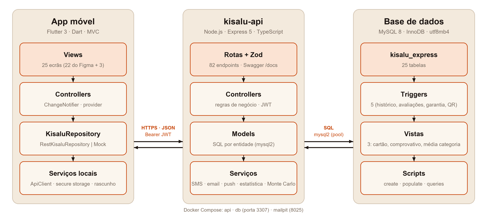
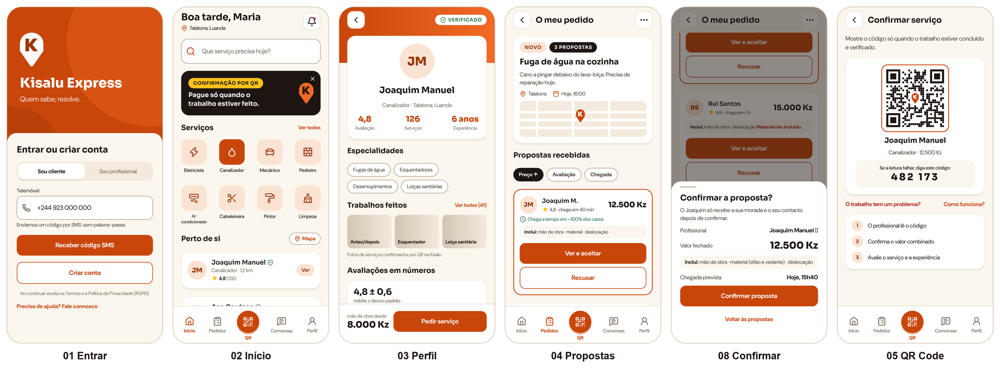
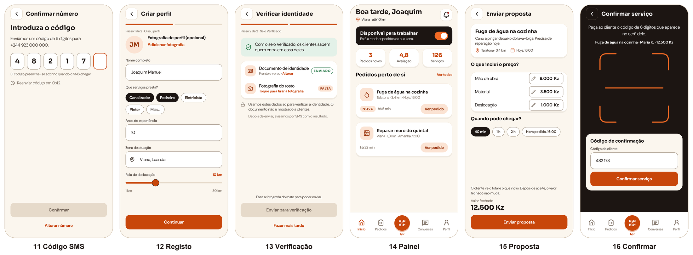
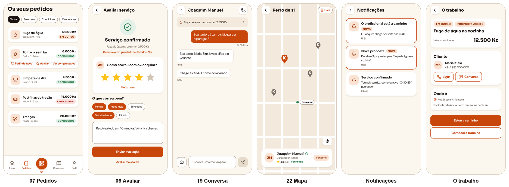
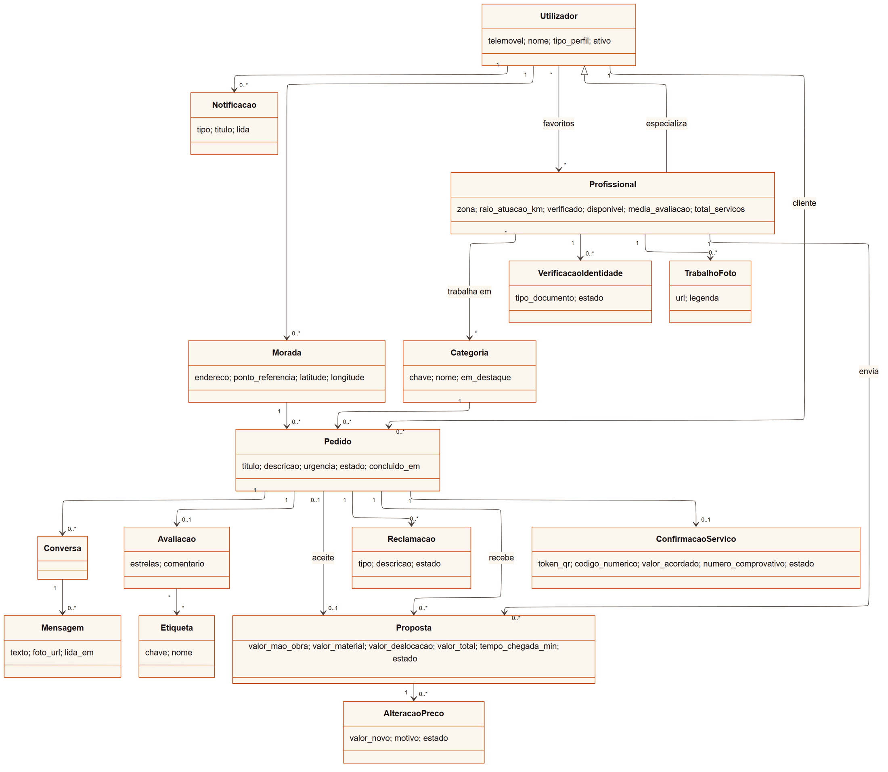
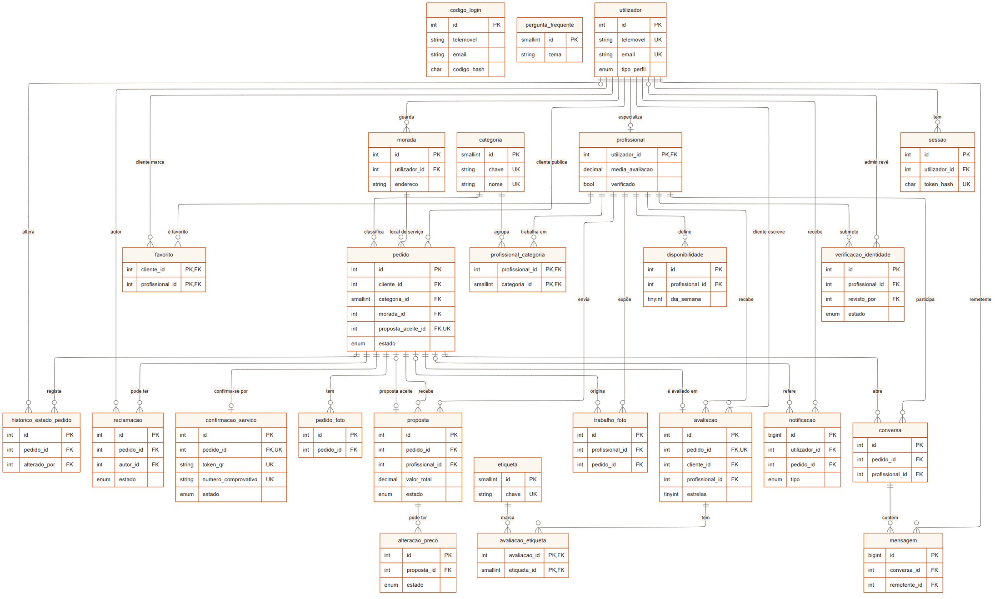
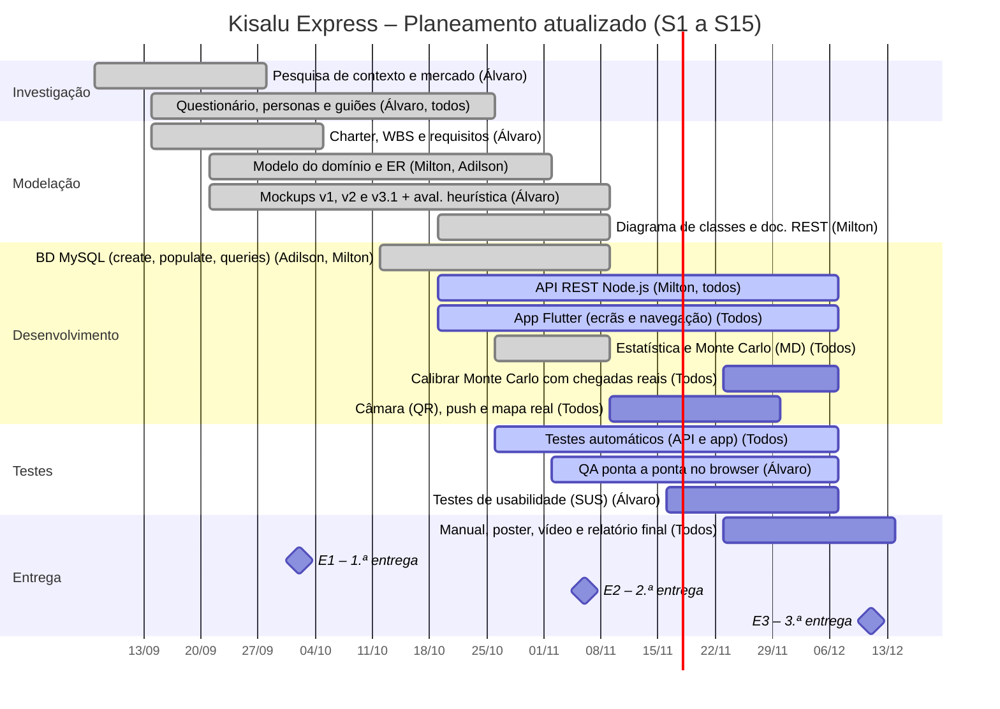

<p align="center"></p>

# Kisalu Express — Relatório Intermédio

**Marketplace móvel de serviços informais em Angola** · Projeto Multidisciplinar Mobile  ·  2.ª Entrega  ·  g05-relatorio-intermedio

Versão PDF: [g05-relatorio-intermedio.pdf](g05-relatorio-intermedio.pdf) · BD Report: [g05-bd-report.md](g05-bd-report.md) · Versão anterior: [g05-proposta-v2.md](g05-proposta-v2.md)

---

## 1. Identificação

|   |   |
|---|---|
| **Universidade** | Universidade Europeia |
| **Faculdade** | IADE – Faculdade de Design, Tecnologia e Comunicação |
| **Curso / UC** | Licenciatura em Engenharia Informática · Projeto de Desenvolvimento Móvel |
| **Grupo** | Grupo 05 · Turma D02 |
| **Elementos** | Álvaro da Silva – 20252049<br>Adilson Yango – 20252312<br>Milton Malavo – 20252099 |
| **Projeto** | Kisalu Express |
| **Repositórios GitHub** | [Kisalu-Express (documentação e entregas)](https://github.com/Eng-Infomatica-IADE/Kisalu-Express)<br>[kissalu-app (app Flutter)](https://github.com/Eng-Infomatica-IADE/kissalu-app)<br>[kisalu-api (API Node.js e base de dados MySQL)](https://github.com/Eng-Infomatica-IADE/kisalu-api) |
| **Figma** | [Kisalu Express — Mockups v3.1](https://www.figma.com/design/y6x5pO2mwQpoiF5ep18mSl/Kisalu-Express-%E2%80%94-Mockups--G05-?node-id=68-2) |
| **Data** | 6 de novembro de 2026 |

## 2. Palavras-chave

Marketplace de serviços; economia informal; biscateiros; Angola; Flutter; API REST; Node.js; MySQL; QR Code; código SMS; reputação verificável; Monte Carlo.

## 3. Descrição da app e problema a resolver

A **Kisalu Express** liga clientes a prestadores de serviços informais em Angola, os “biscateiros”: canalizadores, eletricistas, mecânicos, pedreiros, técnicos de ar condicionado, cabeleireiras. O nome junta “kisalu” (trabalho, em kimbundu) a “express”. A promessa da marca é **“Quem sabe, resolve.”**

Hoje estes serviços contratam-se por recomendação ou em grupos de WhatsApp. O questionário de outubro (n = 8) mostrou que isso não chega: 5 em 7 clientes escolheram por recomendação e todos tiveram pelo menos um problema. O preço mudou no fim em 4 de 7 casos, 5 em 7 tiveram trabalho mal feito e quase ninguém ficou com comprovativo. Abrir a porta a um desconhecido é também uma questão de segurança.

A app responde com **propostas de preço fechado**, **perfis verificados com fotos de trabalhos**, **pesquisa por proximidade**, **confirmação do serviço por QR Code ou código de 6 dígitos**, **comprovativo**, **reporte de problemas até 7 dias** e **avaliações só de serviços confirmados**.

## 4. Objetivos e motivação

O grupo conhece a realidade angolana: encontrar um profissional de confiança é difícil e muitos trabalhadores qualificados não chegam a novos clientes. Os participantes do questionário dariam 4,4 em 5 a uma app como esta.

- App Flutter para Android e iOS, com perfil de cliente e de profissional na mesma conta.

- Ciclo completo pedido → propostas → aceitação → serviço → confirmação por QR → avaliação.

- O preço combinado é o preço pago; alterações só com aprovação do cliente.

- API REST Node.js e base de dados MySQL documentadas, com dados de exemplo coerentes.

- Métodos de Matemática Discreta com uso real na app: estatística das avaliações e Monte Carlo para a hora de chegada.

- Metas de experiência: pedido publicado em 60 s ou menos, ecrãs críticos em WCAG 2.2 AA, SUS ≥ 75, RGPD.

## 5. Público-alvo e personas (versão final)

As personas foram fechadas na Fase 1 de Interfaces e Usabilidade, com base no questionário. Mantêm-se como referência para os guiões e para os dados de exemplo da BD (a Maria e o Joaquim existem no `populate.sql`).

|  | Maria Kiala · cliente (persona primária) | Joaquim Manuel · profissional (persona secundária) |
|---|---|---|
| **Perfil** | 29 anos, gestora de projetos, Talatona (Luanda). iPhone, dados móveis e Wi-Fi. Usa WhatsApp e Multicaixa Express. | 41 anos, canalizador e pedreiro independente. Android de gama média, dados com saldo controlado. |
| **Objetivos** | Saber o preço final antes de começar; só deixar entrar quem tem identidade verificada; ver fotos de trabalhos; ter garantia. | Trabalho regular, também fora do bairro; mostrar o histórico a quem não o conhece; receber o valor combinado. |
| **Frustrações** | Preço que sobe no fim, trabalho mal feito, atrasos, nenhum rasto depois do serviço. | Falta de clientes; não vê vantagem numa app (nota 1 em 5); perde clientes quando não há acordo no preço. |
| **O que a app faz por ela/ele** | Propostas comparáveis com o que incluem, selo Verificado, QR com comprovativo, “O trabalho tem um problema?”. | Registo em 2 passos com o telemóvel, proposta por componentes, portefólio a partir de serviços confirmados, morada só depois de aceite. |

A amostra é pequena e urbana, e só um profissional respondeu ao bloco próprio. A adesão dos profissionais continua a ser o maior risco e será o foco dos testes de usabilidade da 3.ª entrega.

## 6. Pesquisa de mercado (resumo)

Analisámos TaskRabbit, Thumbtack, Fixando e GetNinjas (fora de Angola), Bumbaki e Conecta Já (Angola) e os grupos de WhatsApp e Facebook. As estrangeiras não estão adaptadas ao contexto angolano; as angolanas são recentes e nenhum participante as referiu. Nenhuma junta as quatro coisas que a Kisalu Express junta: **várias propostas com preço fechado**, **portefólio ligado a serviços confirmados**, **confirmação presencial por QR com comprovativo** e **reporte de problemas**, numa app nativa. A comparação completa está na proposta v2 (secção 6).

## 7. Guiões de teste (versão final)

Os guiões seguem o protótipo alfa tal como está implementado (números dos ecrãs entre parênteses) e usam os dados de exemplo da BD, por isso podem ser executados tal como estão.

### 7.1 Caso core – Pedir um serviço e confirmar por QR Code

**Ator:** Maria (cliente). **Pré-condição:** conta com morada em Talatona.

1. No Login (01) escolhe **Sou cliente**, escreve o telemóvel e toca em **Receber código SMS**; introduz os 6 dígitos (11).
2. No Início (02) toca em **Canalizador** e descreve “Fuga de água na cozinha”, com foto opcional, morada e ponto de referência, e quando (10). Publica.
3. A app avisa que os canalizadores da zona foram notificados. Em **Pedidos** abre o pedido (04): três propostas com preço fechado, o que incluem, chegada e estrelas. Ordena por preço.
4. Abre o perfil do Joaquim (03): 4,8 ★, Verificado, trabalhos feitos. Volta e toca em **Ver e aceitar**.
5. Na folha **Confirmar a proposta?** (08) revê 12.500 Kz e a chegada prevista, e confirma. Pode desfazer nos 5 minutos seguintes.
6. O pedido passa a **Aceite**; a Maria troca mensagens na Conversa (19) e recebe notificações quando ele está a caminho e quando começa.
7. No fim abre o QR (05). O Joaquim escreve o código de 6 dígitos no ecrã 16. O pedido fica **Concluído** e o comprovativo KX-2026-… fica guardado.
8. A app abre a Avaliação (06): 5 estrelas, “Pontual” e “Preço justo”. A média do Joaquim é recalculada.

### 7.2 Caso 2 – Registo do profissional e envio de proposta

**Ator:** Joaquim (profissional).

1. No Login (01) escolhe **Sou profissional** e **Criar conta**; valida o telemóvel com o código SMS (11).
2. Passo 1 de 2 (12): fotografia opcional, serviços (Canalizador, Pedreiro), anos de experiência, zona e raio de 1 a 30 km.
3. Passo 2 de 2 (13): fotografa o documento e o rosto e toca em **Enviar para verificação** (ou “Fazer mais tarde”). O admin aprova e o selo **Verificado** aparece no perfil.
4. No Início do profissional (14) liga **Disponível para trabalhar** e vê o pedido “Reparar muro do quintal · Viana”, marcado NOVO.
5. Em **Enviar proposta** (15) preenche mão de obra 9.000, material 6.000 e deslocação 1.000 Kz; a app mostra o total fechado de 16.000 Kz e envia.

### 7.3 Caso 3 – Reportar um problema e pedir de novo

**Ator:** Maria (cliente), depois do caso core.

1. Dois dias depois a fuga volta. Em **Pedidos** (07) filtra **Concluídos** e abre o comprovativo da “Fuga de água”.
2. Toca em **Reportar problema** (só aparece dentro da garantia de 7 dias), escolhe “Trabalho mal feito”, descreve e envia.
3. A app mostra “Problema enviado” e o contacto do Joaquim, que é notificado. Fora do prazo, a app mostra o erro da garantia.
4. Numa próxima avaria toca em **Pedir de novo**: o novo pedido abre já preenchido e pode ser editado antes de publicar.

### 7.4 Caso 4 – Sem rede e QR sem serviço (desvios)

1. A Maria começa um pedido no metro e perde a rede no passo 3 (10): o rascunho fica no aparelho e, ao voltar a rede, retoma no mesmo passo (RM07).
2. Sem nenhum serviço aceite, toca no botão QR da barra: o ecrã 09 explica que o QR só existe depois de aceitar uma proposta e leva aos pedidos.

## 8. Descrição da solução

### i. Descrição genérica

Sistema cliente-servidor em três camadas: **app Flutter** (cliente e profissional na mesma app), **API REST** em Node.js com a lógica de negócio e **base de dados MySQL**. A app pode correr com dados fictícios (repositório *mock*) ou ligada à API, com as mesmas views e controllers. A autenticação é por código SMS de uso único e sessão JWT, sem palavra-passe.

### ii. Enquadramento nas Unidades Curriculares

| Unidade Curricular | Contribuição nesta entrega |
|---|---|
| **Projeto de Desenvolvimento Móvel** | Planeamento em GitHub Projects (milestones M0–M5), relatórios e apresentações. |
| **Programação de Dispositivos Móveis** | App Flutter em MVC (25 views), API Node.js REST com 82 endpoints, documentação bocoup e Swagger, Git. |
| **Bases de Dados** | Modelo ER com 25 tabelas, `create.sql` (tabelas, 5 triggers, 3 vistas), `populate.sql` e `queries.sql`; BD Report. |
| **Redes e Comunicação de Dados** | Cliente-servidor sobre HTTP(S) com JSON, autenticação Bearer (JWT), CORS por lista de origens, limites de pedidos de código (429), cabeçalhos de segurança (helmet); API, MySQL e Mailpit em contentores Docker na mesma rede do Compose. |
| **Interfaces e Usabilidade** | Personas, guiões, avaliação heurística da v1 (22 problemas) e dos ecrãs 11–22 (30 problemas, 24 corrigidos na v3.1), Style Guide; testes SUS na 3.ª entrega. |
| **Matemática Discreta** | Estatística descritiva e inferencial das avaliações (intervalo de confiança, média bayesiana) e método de Monte Carlo para a hora de chegada (secção 14). |

### iii. Requisitos técnicos

- **Flutter 3.47 / Dart 3.13**, alvo Android e iOS (web só para pré-visualização); `go_router`, `provider`, `http`, `flutter_secure_storage`.

- **Node.js 20+, Express 5 e TypeScript**; validação com Zod; Swagger gerado das mesmas definições de rota.

- **MySQL 8** (ou MariaDB 10.6+), utf8mb4, datas em UTC, valores em Kz `DECIMAL(12,2)`.

- **Docker Compose** para MySQL, API e Mailpit; `npm run db:reset` recria a BD a partir dos scripts.

- Segurança: JWT, hash SHA-256 dos códigos, QR opaco válido 10 min, 5 tentativas no código, documentos de identidade fora de `/uploads`.

- Rede instável: imagens comprimidas a 1280 px, rascunho local, mensagens de erro com solução (RNF07).

### iv. Arquitetura da solução



*Figura 1 – Arquitetura cliente-servidor: app Flutter (MVC), kisalu-api (rotas, controllers, models, serviços) e MySQL.*

Todas as respostas da API usam o mesmo envelope `{ title, status, detail, instance, data }`. O `detail` traz a mensagem em português pronta a mostrar e os erros HTTP são convertidos em exceções Dart no `RestKisaluRepository`. O contrato entre os dois lados está em `docs/CONTRATO-APP.md`.

### v. Tecnologias

| Camada | Tecnologias |
|---|---|
| **Mobile** | Flutter, Dart, go_router, provider, http, qr_flutter, flutter_secure_storage, shared_preferences, google_fonts, lucide_icons_flutter |
| **Backend** | Node.js, Express 5, TypeScript, mysql2, jsonwebtoken, Zod + zod-to-openapi, swagger-ui-express, helmet, cors, multer + sharp (imagens), nodemailer; SMS simulado |
| **Dados** | MySQL 8, MySQL Workbench, Docker |
| **Testes** | Vitest + Supertest contra MySQL real (API); flutter_test (widgets, controllers, fluxos) |
| **Design e gestão** | Figma (v1, v2, v3.1), Style Guide, Git, GitHub, GitHub Projects |

## 9. Protótipo alfa: o que foi implementado

A 2.ª entrega pedia um servidor funcional, a BD e a app a consumir serviços. Os três estão feitos e ligados.

| Componente | Estado na entrega E2 |
|---|---|
| **App Flutter** | Os **22 ecrãs** do Figma (01–10 da v2, 11–22 da v3.1) e **3 ecrãs novos** vindos do QA: Notificações, Ajuda e “O trabalho” (detalhe do profissional). Fluxos de cliente e de profissional completos, com sessão mantida e rascunho local. |
| **API REST** | **82 endpoints** em 10 grupos (secção 11), Swagger em `/docs`, regras de negócio críticas na API e repetidas na BD (triggers). |
| **Base de dados** | 25 tabelas, 5 triggers, 3 vistas; dados de exemplo iguais aos do mock da app (secção 13 e BD Report). |
| **Integração** | Com `--dart-define=KISALU_API=…` a app usa o `RestKisaluRepository`; sem ele, os dados fictícios. 401 limpa a sessão e volta ao Login. |
| **Testes** | **83 testes** automáticos na API em 7 ficheiros (Vitest + Supertest sobre uma BD de teste, incluindo os métodos de Matemática Discreta com valores calculados à mão) e **703** na app (componentes, controllers, ecrãs e fluxos). QA ponta a ponta no browser com a API real: 18 correções (QA-F1 a QA-F18), todas fechadas. |



*Figura 2 – Caminho do cliente: entrar, início, perfil, propostas, confirmar a proposta e QR.*



*Figura 3 – Caminho do profissional: código SMS, registo em 2 passos, painel, proposta e confirmação com código.*



*Figura 4 – Pedidos, avaliação, conversa, mapa e dois dos ecrãs acrescentados depois do QA.*

**Ainda por fazer:** leitura do QR com a câmara (o ecrã 16 usa o código de 6 dígitos), notificações push reais (já ficam gravadas e são devolvidas pela API), mapa real (o ecrã 22 é estático), SMS real, revisão de acessibilidade completa (Q-04) e APK num telemóvel (Q-07).

## 10. Diagrama de classes (esboço)

Diagrama conceptual com as entidades do domínio e as relações entre elas. Os atributos mostrados são os mais importantes; as multiplicidades vêm das chaves estrangeiras e das restrições `UNIQUE` da BD. O **Pedido** é o centro: recebe propostas, aceita uma, e é a partir dele que nascem a confirmação, a avaliação, as reclamações e as conversas.



*Figura 5 – Diagrama de classes conceptual (a versão com todos os atributos está em kisalu-api/docs/DADOS.md).*

- **Profissional** é uma especialização de **Utilizador**: a mesma pessoa pode usar a app como cliente e como profissional.

- Entre **Pedido** e **Proposta** há duas associações: 1 para N (propostas recebidas) e 0..1 para 0..1 (a proposta aceite).

- **ConfirmacaoServico** e **Avaliacao** são no máximo uma por pedido; **AlteracaoPreco** pertence à proposta, porque é o acordo que muda.

## 11. Documentação REST (primeira versão)

A documentação completa está no formato bocoup em [kisalu-api/docs/API-REST.md](https://github.com/Eng-Infomatica-IADE/kisalu-api/blob/main/docs/API-REST.md), gerada a partir da especificação OpenAPI (a mesma do Swagger), por isso acompanha sempre o código. Base: `http://localhost:3000/api`. Autenticação: `Authorization: Bearer <token>`.

### 11.1 Resumo por grupo

| Grupo | N.º | Exemplos |
|---|---|---|
| **Autenticação e conta** | 10 | `POST /auth/sms/pedir`, `POST /auth/sms/verificar`, `GET /eu`, `PUT /eu/perfil-ativo`, `DELETE /eu` (RGPD) |
| **Catálogo e ajuda** | 3 | `GET /categorias`, `GET /etiquetas`, `GET /ajuda/perguntas` |
| **Profissionais** | 16 | `GET /profissionais/perto`, `GET /profissionais/{id}`, `GET /profissionais/{id}/estatisticas`, `PUT /profissionais/eu`, verificação de identidade, galeria |
| **Moradas e favoritos** | 7 | `GET/POST/PUT/DELETE /moradas`, `PUT/DELETE /favoritos/{id}` |
| **Pedidos** | 15 | `POST /pedidos`, `GET /pedidos/{id}`, `PATCH /pedidos/{id}/estado`, `POST /pedidos/{id}/pedir-de-novo` |
| **Propostas** | 9 | `POST /pedidos/{id}/propostas`, `POST /propostas/{id}/aceitar`, `GET /propostas/{id}/estimativa-chegada`, alterações de preço |
| **Confirmação por QR** | 4 | `GET /pedidos/{id}/qr`, `POST /pedidos/confirmar`, `GET /pedidos/{id}/comprovativo` |
| **Garantia e avaliação** | 3 | `POST /pedidos/{id}/reclamacoes`, `POST /pedidos/{id}/avaliacao` |
| **Conversas e notificações** | 9 | `GET /conversas`, `POST /conversas/{id}/mensagens`, `GET /notificacoes` |
| **Administração** | 6 | `GET /admin/verificacoes`, `POST /admin/verificacoes/{id}/decidir`, `PATCH /admin/reclamacoes/{id}` |

Formato de todas as respostas: `{ "title", "status", "detail", "instance", "data" }`. Nos erros, `data` traz `{ "codigo", "detalhes?" }`. Códigos usados: 200, 201, 400, 401, 403, 404, 409, 422 e 429.

### 11.2 Enviar código de entrada por SMS (RF01)

|   |   |
|---|---|
| **Title** | Enviar código de entrada por SMS (RF01) |
| **URL** | `/api/auth/sms/pedir` |
| **Method** | `POST` |
| **Autenticação** | Pública (sem token). |
| **URL Params** | Nenhum. |
| **Data Params** | `telemovel` (string, obrigatório: +244 e 9 dígitos começados por 9) · `perfil` (`cliente` \| `profissional`, omissão `cliente`) · `criar_conta` (boolean, omissão false). |
| **Success Response** | **200** · `data`: `{ mensagem, expira_em_min: 5, reenviar_em_s: 60, codigo_dev? }`. A resposta é igual para números novos e existentes. |
| **Error Response** | **400** `VALIDACAO` (número inválido) · **429** novo pedido antes de 60 s ou limite de códigos em 10 min. |
| **Notes** | O SMS é simulado (`services/sms.ts`); fora de produção o código vem em `codigo_dev`. Guarda-se só o hash SHA-256 do código. |

**Sample Call** e resposta (`data` do envelope):

```bash
curl -X POST "http://localhost:3000/api/auth/sms/pedir" \
  -H "Content-Type: application/json" \
  -d '{"telemovel":"+244923000000","perfil":"cliente"}'

{ "title": "Sucesso", "status": 200, "detail": "Pedido processado.", "instance": "/api/auth/sms/pedir",
  "data": { "mensagem": "Enviámos um código por SMS para +244 923 000 000.", "expira_em_min": 5, "reenviar_em_s": 60, "codigo_dev": "482173" } }
```

### 11.3 Criar pedido de serviço (RF03, ecrã 10)

|   |   |
|---|---|
| **Title** | Criar pedido de serviço (RF03, ecrã 10) |
| **URL** | `/api/pedidos` |
| **Method** | `POST` |
| **Autenticação** | Obrigatória: `Authorization: Bearer <token>` (cliente). |
| **URL Params** | Nenhum. |
| **Data Params** | `titulo` (3–100 car., obrigatório) · `descricao` (5–2000 car., obrigatório) · `categoria_chave` ou `categoria_id` · `morada_id` ou `zona` + `ponto_referencia` · `urgencia` (`o_mais_cedo_possivel` \| `agendado`) · `data_pretendida` · `publicar` (omissão true). |
| **Success Response** | **201** · `data`: `{ id, estado, pedido: PedidoJSON, profissionais_avisados, categoria_plural }`. |
| **Error Response** | **400** `VALIDACAO` · **401** `NAO_AUTENTICADO` · **403** `SEM_PERMISSAO` (perfil profissional) · **404** categoria ou morada inexistente. |
| **Notes** | Ao publicar, notifica os profissionais da categoria dentro do raio de atuação. Com `publicar: false` fica em rascunho (RM07). |

**Sample Call** e resposta (`data` do envelope):

```bash
curl -X POST "http://localhost:3000/api/pedidos" -H "Authorization: Bearer <token>" \
  -H "Content-Type: application/json" \
  -d '{"categoria_chave":"canalizador","titulo":"Fuga de água na cozinha",
       "descricao":"Cano a pingar debaixo do lava-loiça.","zona":"Talatona",
       "ponto_referencia":"perto da cantina do Sr. Zé","publicar":true}'

"data": { "id": 11, "estado": "publicado", "profissionais_avisados": 3,
          "categoria_plural": "canalizadores", "pedido": { "id": 11, "titulo": "Fuga de água na cozinha", ... } }
```

### 11.4 Aceitar proposta e fechar o acordo (RF05, ecrã 08)

|   |   |
|---|---|
| **Title** | Aceitar proposta e fechar o acordo (RF05, ecrã 08) |
| **URL** | `/api/propostas/{id}/aceitar` |
| **Method** | `POST` |
| **Autenticação** | Obrigatória: `Authorization: Bearer <token>` (cliente dono do pedido). |
| **URL Params** | **Required:** `id=[integer]` (proposta, no caminho). |
| **Data Params** | Nenhum. |
| **Success Response** | **200** · `data`: `{ pedido_id, titulo, profissional, profissional_telemovel, valor_acordado, valor_formatado, inclui, hora_prevista_chegada, conversa_id, mensagem }`. |
| **Error Response** | **401** · **403** não é o cliente do pedido · **404** proposta inexistente · **409** `CONFLITO` o pedido já tem proposta aceite. |
| **Notes** | Uma só transação: aceita esta proposta, recusa as outras, passa o pedido a `aceite`, cria a `confirmacao_servico` (token do QR + código de 6 dígitos) e abre a conversa. Só então o profissional vê a morada e o telemóvel (RNF10). |

**Sample Call** e resposta (`data` do envelope):

```bash
curl -X POST "http://localhost:3000/api/propostas/1/aceitar" -H "Authorization: Bearer <token>"

"data": { "pedido_id": 1, "titulo": "Fuga de água na cozinha", "profissional": "Joaquim Manuel",
          "valor_acordado": 12500, "valor_formatado": "12 500 Kz", "inclui": "Mão de obra · material · deslocação",
          "hora_prevista_chegada": "2026-11-06T15:40:00Z", "conversa_id": 1,
          "mensagem": "Acordo fechado. O preço só muda se aprovar uma alteração na app." }
```

### 11.5 Confirmar o serviço com o código (RF10, ecrã 16)

|   |   |
|---|---|
| **Title** | Confirmar o serviço com o código (RF10, ecrã 16) |
| **URL** | `/api/pedidos/confirmar` |
| **Method** | `POST` |
| **Autenticação** | Obrigatória: `Authorization: Bearer <token>` (profissional). |
| **URL Params** | Nenhum. |
| **Data Params** | `codigo` (6 dígitos, aceita "482 173") ou `token_qr` (lido do QR, `kx_qr_…`) · `metodo_pagamento` (`dinheiro` \| `multicaixa_express` \| `transferencia`). |
| **Success Response** | **200** · `data`: ComprovativoJSON `{ numero_comprovativo, pedido_id, titulo, cliente, profissional, valor_kz, metodo_pagamento, metodo_confirmacao, confirmado_em, partilha_whatsapp }`. |
| **Error Response** | **400** código errado (conta uma tentativa) · **404** `SEM_SERVICO_POR_CONFIRMAR` · **409** alteração de preço pendente · **429** 5 códigos errados. |
| **Notes** | A API procura, entre os serviços do profissional com confirmação pendente, o que tem aquele código. O trigger `trg_confirmacao_concluir` passa o pedido a `concluido` e soma o serviço ao perfil. |

**Sample Call** e resposta (`data` do envelope):

```bash
curl -X POST "http://localhost:3000/api/pedidos/confirmar" -H "Authorization: Bearer <token>" \
  -H "Content-Type: application/json" -d '{"codigo":"482173","metodo_pagamento":"dinheiro"}'

"data": { "numero_comprovativo": "KX-2026-000009", "pedido_id": 1, "titulo": "Fuga de água na cozinha",
          "cliente": "Maria Kiala", "valor_kz": 12500, "metodo_pagamento": "dinheiro",
          "metodo_confirmacao": "codigo", "confirmado_em": "2026-11-06T17:02:11Z", ... }
```

## 12. Dicionário de dados e modelo ER (primeira versão)

A base `kisalu_express` tem **25 tabelas** em InnoDB, **5 triggers** e **3 vistas**. O dicionário completo (todas as colunas, tipos, nulos, chaves e omissões) está no BD Report e em `kisalu-api/docs/DADOS.md`.

| Área | Tabelas e papel no modelo |
|---|---|
| **Contas** | `utilizador` (conta única, telemóvel UQ), `codigo_login` (hash do código SMS/email, sem FK), `sessao` (token, perfil ativo, push). |
| **Profissionais** | `profissional` (1:1 com utilizador, PK = FK), `categoria`, `profissional_categoria` (N:M), `verificacao_identidade`, `disponibilidade`. |
| **Moradas** | `morada` (GPS + ponto de referência), `favorito` (N:M cliente–profissional). |
| **Pedidos** | `pedido` (8 estados), `pedido_foto`, `historico_estado_pedido` (preenchido por trigger). |
| **Propostas** | `proposta` (valor total como coluna gerada; UQ pedido + profissional), `alteracao_preco`. |
| **Confirmação** | `confirmacao_servico` (1:1 com pedido; token QR, código, comprovativo, pagamento). |
| **Pós-serviço** | `reclamacao`, `avaliacao` (UQ pedido), `etiqueta`, `avaliacao_etiqueta` (N:M), `trabalho_foto`. |
| **Comunicação** | `conversa` (UQ pedido + profissional), `mensagem`, `notificacao`, `pergunta_frequente`. |

#### Exemplo de entrada do dicionário: proposta

| Coluna | Tipo | Nulo | Chave / descrição |
|---|---|---|---|
| id | INT UNSIGNED AI | não | PK |
| pedido_id | INT UNSIGNED | não | FK → pedido(id) CASCADE; UQ (pedido_id, profissional_id) |
| profissional_id | INT UNSIGNED | não | FK → profissional RESTRICT |
| valor_mao_obra / _material / _deslocacao | DECIMAL(12,2) | não | Componentes do preço, ≥ 0 |
| valor_total | DECIMAL(12,2) | não | Coluna gerada (STORED): soma dos três |
| tempo_chegada_min | SMALLINT | sim | Obrigatório se `na_hora_pedida` for falso |
| estado | ENUM | não | enviada · aceite · recusada · retirada · expirada |

**Regras que a BD garante sozinha:** só se avalia um serviço concluído e pelo próprio cliente (`trg_avaliacao_valida`); a média de estrelas atualiza-se a cada avaliação (`trg_avaliacao_media`); reclamações só depois de aceite e até 7 dias após a conclusão (`trg_reclamacao_garantia`); confirmar o QR conclui o pedido e soma o serviço (`trg_confirmacao_concluir`); cada mudança de estado fica no histórico (`trg_pedido_historico`).



*Figura 6 – Modelo ER (notação pé-de-galinha), com as chaves de cada tabela.*

## 13. Guia de Dados (esboço)

O `populate.sql` cria uma BD de teste pequena mas coerente, com os mesmos nomes do mock da app, para que a app mostre o mesmo com ou sem servidor. Todos os dados são fictícios. O guia completo, com contagens por tabela e o cenário de cada conjunto, está no BD Report.

| Conjunto | Para que serve |
|---|---|
| **14 utilizadores**: 6 clientes, 7 profissionais, 1 admin | Entrar com qualquer perfil; Maria Kiala (+244 923 000 000) e Joaquim Manuel (+244 923 000 002) são as personas. |
| **13 categorias**, 5 etiquetas, 3 perguntas frequentes | Grelha do Início (8 em destaque), Todos os serviços, avaliação e Ajuda. |
| **10 pedidos** em 4 estados | Pedido 1 com 3 propostas (caso core); 6 concluídos e 2 cancelados (histórico); pedido 10 publicado (painel do profissional). |
| **11 propostas**, 8 confirmações, 5 avaliações | Comparar propostas, comprovativos KX-2026-…, perfil com avaliações e etiquetas. |
| **3 conversas** com 7 mensagens, 2 notificações | Lista de conversas, mensagens por ler e sino com novidades. |

## 14. Matemática Discreta

Escolhemos dois problemas reais da app, um de estatística e outro de simulação. Os dois estão na API (`src/services/estatistica.ts` e `monteCarlo.ts`, funções puras com testes automáticos) e aparecem nos ecrãs. A descrição completa, com as contas, está em `kisalu-api/docs/MATEMATICA.md`.

### 14.1 Estatística das avaliações

Cada profissional guarda a **distribuição** das estrelas recebidas (colunas `avaliacoes_1` a `avaliacoes_5`; o trigger `trg_avaliacao_media` soma 1 à coluna certa e recalcula total e média). Sobre essa amostra a API calcula **média**, **mediana** (com n par, média dos dois do meio), **moda** (em empate, a menor), **variância** e **desvio padrão amostrais** (divisor n − 1) e um **intervalo de confiança a 95 %** para a média, x̄ ± c·s/√n, com c = t de Student com n − 1 graus de liberdade quando n < 30 e c = z = 1,96 quando n ≥ 30, cortado a [1, 5].

Uma média de 5,0 com 2 avaliações não vale o mesmo que 4,8 com 126. Para ordenar a pesquisa (`GET /profissionais?ordenar=avaliacao`, verificados primeiro) usamos a **média bayesiana** (m·C + Σxᵢ) / (m + n), com m = 10 e C a média global da categoria (vista `vw_media_categoria`). Com poucas avaliações o valor fica perto de C; com muitas, perto da média do próprio profissional.

| Exemplo | Resultado de `GET /profissionais/{id}/estatisticas` |
|---|---|
| **Joaquim** (n = 126) | Distribuição 1 · 1 · 3 · 13 · 108; média 4,79; mediana e moda 5; variância 0,357; s = 0,60; IC 95 % (z) = [4,69 ; 4,90]; média bayesiana 4,79 (C = 4,783). |
| **Hélder** (n = 28) | Média 4,39; s = 0,83; t₀,₉₇₅;₂₇ = 2,052; IC 95 % (t) = [4,07 ; 4,72]. |
| **Profissional novo** | Duas avaliações de 5 ★ numa categoria com C = 4,78 dão 4,82 (e não 5,0); uma terceira de 3 ★ desce-o para 4,68, abaixo do Joaquim. Uma nota fraca do Joaquim quase não lhe mexe. |

No perfil (ecrã 03), o bloco **“Avaliações em números”** mostra “4,8 ± 0,6”, “Entre 4,7 e 4,9 com 95 % de confiança”, barras com a distribuição de 5 a 1 estrelas e “n = 126 avaliações”.

### 14.2 Monte Carlo para a hora de chegada

A proposta promete “chega em X min”, mas o trânsito em Luanda torna isso incerto. Não há fórmula fechada simples para esta soma de variáveis, por isso a API simula N = 10 000 chegadas:

```
T = P + d / V · 60 + A
  P (preparação) ~ Uniforme(5, 15) min
  d (distância)  = Haversine em linha reta entre a zona do profissional e a morada, em km
  V (velocidade) : ln V ~ Normal(ln 18; 0,5²) km/h   (mediana 18 km/h; normal por Box-Muller)
  A (atraso)     ~ Uniforme(5, 25) min com probabilidade 0,3; 0 nos outros casos
```

O gerador mulberry32 usa a semente id × 2654435761 mod 2³², por isso a mesma proposta dá sempre o mesmo resultado. Saem a **média**, o **p50** e o **p90** (percentis pelo posto mais próximo) e a **probabilidade de cumprir**, #{Tⱼ ≤ X} / N, com erro padrão ≤ 0,005. Um teste automático compara a média simulada com a teórica, 10 + d·(60/18)·e^(σ²/2) + 0,3·15.

| Pedido 1 da Maria | Distância | Prometido | Média / p50 / p90 | Probabilidade de cumprir |
|---|---|---|---|---|
| Joaquim | 1,2 km | 40 min | 19,0 / 16,6 / 32,8 min | 0,98 → “~100 %” |
| Rui | 1,8 km | 60 min | 21,5 / 18,9 / 35,7 min | 1,00 → “~100 %” |
| Paulo | 2,9 km | 25 min | 25,5 / 23,1 / 40,1 min | 0,576 → “~60 %” |

Endpoint: `GET /propostas/{id}/estimativa-chegada` → `{ proposta_id, distancia_km, tempo_prometido_min, simulacoes, media_min, p50_min, p90_min, prob_cumprir }`; o mesmo vem como `estimativa_chegada` em cada proposta que o cliente vê. No cartão da proposta (ecrã 04) aparece **“Chega a tempo em ~X % dos casos”**, arredondado a 5 %, a verde a partir de 80 % e com ícone de aviso abaixo disso. O p50 só desempata a ordenação por chegada. O Paulo promete o tempo mais curto, mas é o que tem menos hipóteses de o cumprir.

## 15. Planeamento atualizado

Sprints de duas semanas em GitHub Projects. S1 = 7 a 11 de setembro; E2 é na semana 9 (6 de novembro). A verde o que está concluído, a laranja o que falta.



*Figura 7 – Gantt atualizado na semana 9 (verde = feito; laranja = por fazer; ◆ = entrega).*

**Distribuição de tarefas.** Álvaro da Silva: coordenação, UX/UI, Figma, QA e testes de usabilidade. Milton Malavo: API REST e integração. Adilson Yango: base de dados (create, populate, queries) com o Milton. O código Node.js e Flutter é partilhado pelos três.

**Para a 3.ª entrega (11.12.2026):**

- Ligar a câmara (leitura do QR), as notificações push (Firebase) e o mapa real; SMS real se o custo o permitir.

- Guardar as horas reais de “A caminho” e “Em curso” para calibrar o Monte Carlo; ver nos testes se a linha “Chega a tempo” ajuda a escolher.

- Revisão de acessibilidade (texto a 200 %, leitores de ecrã, contraste) e APK num telemóvel Android.

- Testes de usabilidade com clientes e, sobretudo, profissionais; questionário SUS.

- Relatório final, manual do utilizador, poster, vídeo e memória documental.

## 16. Alterações face à proposta v2

| Alteração | Razão |
|---|---|
| Back-end em **TypeScript + Express 5**, com Zod e Swagger | Tipos partilhados entre rotas, validação e documentação; menos erros de integração. |
| Modelo do domínio de 11 entidades passou a **25 tabelas** | Sessões, códigos, verificação, disponibilidade, histórico, etiquetas, conversas e notificações precisavam de tabela própria. |
| Entrada também por **email**, além do SMS | Alternativa enquanto o SMS é simulado. |
| Registo do profissional em **2 passos** (era 3) | Avaliação heurística dos ecrãs 11–22 (V01). |
| Ecrã 16 com **código de 6 dígitos**, sem câmara | A leitura do QR com câmara fica para a E3; o código já cumpre RF10. |
| **Mapa estático** em vez de Google Maps | Evita chave paga e dados móveis; o mapa era secundário na pesquisa (3,0/5). |
| **3 ecrãs novos** e ações extra (recusar, desfazer aceitação, editar pedido) | Vieram do QA ponta a ponta com a API real. |
| Matemática Discreta: **média bayesiana e IC** em vez de intervalos de preço | A reputação é o que mais pesa na escolha; os preços de exemplo eram poucos para estimar intervalos. |

## 17. Conclusão

A 2.ª entrega fecha o protótipo alfa: a app Flutter tem os 22 ecrãs do Figma e mais 3, a API responde a 82 endpoints e a BD de exemplo permite correr os quatro guiões de ponta a ponta. As regras que dão confiança ao produto (preço fechado, morada só depois de aceitar, conclusão só com o código do cliente, garantia de 7 dias) estão na API e repetidas na BD.

O que falta é sobretudo integração com o dispositivo (câmara, push, mapa) e validação com pessoas reais. O maior risco continua do lado do profissional: os testes de usabilidade da 3.ª entrega vão incluir pelo menos três profissionais.

## 18. Bibliografia

- Bocoup. (2013). Documenting your API. https://bocoup.com/blog/documenting-your-api

- Bumbaki. (2026). Bumbaki – Contratação de serviços. https://bumbaki.com

- Conecta Já. (2026). Conecta Já – Plataforma de serviços em Angola. https://conectaja-ao.github.io/ConectaJa.ao/

- Express. (2026). Express 5 – Node.js web application framework. https://expressjs.com

- Fixando. (2026). Fixando – Encontre profissionais. https://fixando.pt

- Google. (2026). Flutter documentation. https://docs.flutter.dev

- Grupo 05 – Kisalu Express. (2026). Questionário “Como contrata (ou presta) serviços de biscato?” [Google Forms, n = 8, 8–13 out. 2026].

- International Labour Organization. (2018). Women and men in the informal economy: A statistical picture (3rd ed.). ILO.

- Metropolis, N., & Ulam, S. (1949). The Monte Carlo method. Journal of the American Statistical Association, 44(247), 335–341.

- Montgomery, D. C., & Runger, G. C. (2014). Applied statistics and probability for engineers (6th ed.). Wiley.

- Nielsen, J. (1994). 10 usability heuristics for user interface design. Nielsen Norman Group. https://www.nngroup.com/articles/ten-usability-heuristics/

- OpenJS Foundation. (2026). Node.js documentation. https://nodejs.org/docs

- Oracle. (2026). MySQL 8.0 reference manual. https://dev.mysql.com/doc/

- Regulamento (UE) 2016/679 do Parlamento Europeu e do Conselho, de 27 de abril de 2016 (Regulamento Geral sobre a Proteção de Dados).

- Rocha, L. C., Andrade, R. M. C., & Sampaio, A. L. (2014). Heurísticas para avaliar a usabilidade de aplicações móveis. In Nuevas Ideas en Informática Educativa TISE (Vol. 10, pp. 367–378).

- Sommerville, I. (2016). Software engineering (10th ed.). Pearson.

- TaskRabbit. (2026). TaskRabbit. https://www.taskrabbit.com

- Thumbtack. (2026). Thumbtack. https://www.thumbtack.com

- Universidade Europeia. (2026). Projeto Mobile – Project Briefing (L-EI), 2026-2027, 3.º semestre.

- W3C. (2023). Web Content Accessibility Guidelines (WCAG) 2.2. https://www.w3.org/TR/WCAG22/
