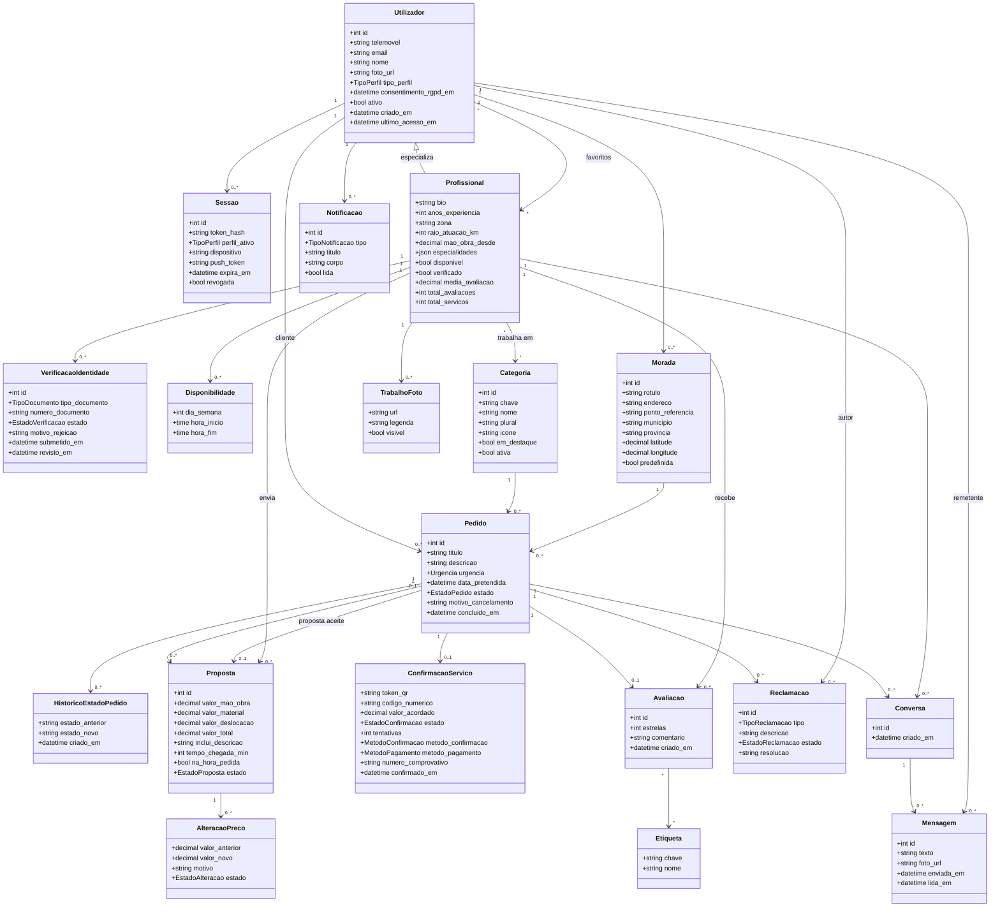

# Kisalu Express · Modelo de dados

Base de dados MySQL 8.0+ `kisalu_express` (utf8mb4), criada por `database/create.sql`. Este documento tem o modelo ER, o dicionário de dados, os triggers e vistas, e o diagrama de classes do domínio. São 25 tabelas, 5 triggers e 2 vistas. Datas em UTC; valores monetários em kwanzas (Kz), `DECIMAL(12,2)`.

Legenda das chaves nas tabelas: **PK** chave primária, **FK** chave estrangeira, **UQ** único.

## 1. Modelo ER

```mermaid
erDiagram
  utilizador ||--o{ sessao : "tem"
  utilizador ||--o| profissional : "especializa"
  utilizador ||--o{ morada : "guarda"
  utilizador ||--o{ pedido : "cliente publica"
  utilizador ||--o{ favorito : "cliente marca"
  utilizador ||--o{ reclamacao : "autor"
  utilizador ||--o{ avaliacao : "cliente escreve"
  utilizador ||--o{ mensagem : "remetente"
  utilizador ||--o{ notificacao : "recebe"
  utilizador |o--o{ verificacao_identidade : "admin revê"
  utilizador |o--o{ historico_estado_pedido : "altera"

  categoria ||--o{ profissional_categoria : "agrupa"
  categoria ||--o{ pedido : "classifica"

  profissional ||--o{ profissional_categoria : "trabalha em"
  profissional ||--o{ verificacao_identidade : "submete"
  profissional ||--o{ disponibilidade : "define"
  profissional ||--o{ favorito : "é favorito"
  profissional ||--o{ proposta : "envia"
  profissional ||--o{ avaliacao : "recebe"
  profissional ||--o{ trabalho_foto : "expõe"
  profissional ||--o{ conversa : "participa"

  morada ||--o{ pedido : "local do serviço"

  pedido ||--o{ pedido_foto : "tem"
  pedido ||--o{ historico_estado_pedido : "regista"
  pedido ||--o{ proposta : "recebe"
  pedido |o--o| proposta : "proposta aceite"
  pedido ||--o| confirmacao_servico : "confirma-se por"
  pedido ||--o{ reclamacao : "pode ter"
  pedido ||--o| avaliacao : "é avaliado em"
  pedido |o--o{ trabalho_foto : "origina"
  pedido ||--o{ conversa : "abre"
  pedido |o--o{ notificacao : "refere"

  proposta ||--o{ alteracao_preco : "pode ter"

  avaliacao ||--o{ avaliacao_etiqueta : "tem"
  etiqueta ||--o{ avaliacao_etiqueta : "marca"

  conversa ||--o{ mensagem : "contém"

  utilizador {
    int id PK
    string telemovel UK
    string email UK
    enum tipo_perfil
  }
  codigo_login {
    int id PK
    string telemovel
    string email
    char codigo_hash
  }
  sessao {
    int id PK
    int utilizador_id FK
    char token_hash UK
  }
  categoria {
    smallint id PK
    string chave UK
    string nome UK
  }
  profissional {
    int utilizador_id PK, FK
    decimal media_avaliacao
    bool verificado
  }
  profissional_categoria {
    int profissional_id PK, FK
    smallint categoria_id PK, FK
  }
  verificacao_identidade {
    int id PK
    int profissional_id FK
    int revisto_por FK
    enum estado
  }
  disponibilidade {
    int id PK
    int profissional_id FK
    tinyint dia_semana
  }
  morada {
    int id PK
    int utilizador_id FK
    string endereco
  }
  favorito {
    int cliente_id PK, FK
    int profissional_id PK, FK
  }
  pedido {
    int id PK
    int cliente_id FK
    smallint categoria_id FK
    int morada_id FK
    int proposta_aceite_id FK, UK
    enum estado
  }
  pedido_foto {
    int id PK
    int pedido_id FK
  }
  historico_estado_pedido {
    int id PK
    int pedido_id FK
    int alterado_por FK
  }
  proposta {
    int id PK
    int pedido_id FK
    int profissional_id FK
    decimal valor_total
    enum estado
  }
  alteracao_preco {
    int id PK
    int proposta_id FK
    enum estado
  }
  confirmacao_servico {
    int id PK
    int pedido_id FK, UK
    string token_qr UK
    string numero_comprovativo UK
    enum estado
  }
  reclamacao {
    int id PK
    int pedido_id FK
    int autor_id FK
    enum estado
  }
  avaliacao {
    int id PK
    int pedido_id FK, UK
    int cliente_id FK
    int profissional_id FK
    tinyint estrelas
  }
  etiqueta {
    smallint id PK
    string chave UK
  }
  avaliacao_etiqueta {
    int avaliacao_id PK, FK
    smallint etiqueta_id PK, FK
  }
  trabalho_foto {
    int id PK
    int profissional_id FK
    int pedido_id FK
  }
  conversa {
    int id PK
    int pedido_id FK
    int profissional_id FK
  }
  mensagem {
    bigint id PK
    int conversa_id FK
    int remetente_id FK
  }
  notificacao {
    bigint id PK
    int utilizador_id FK
    int pedido_id FK
    enum tipo
  }
  pergunta_frequente {
    smallint id PK
    string tema
  }
```

Notas sobre o modelo:

* `codigo_login` e `pergunta_frequente` não têm chaves estrangeiras. O código de login liga-se à conta pelo telemóvel ou pelo email, não por FK.
* `profissional` é uma especialização 1:1 de `utilizador` (a PK é também FK). Só existe para quem trabalha como profissional.
* `categoria` e `profissional` ligam-se por N:M através de `profissional_categoria`. `avaliacao` e `etiqueta` ligam-se por N:M através de `avaliacao_etiqueta`.
* Há duas relações entre `pedido` e `proposta`. Uma é 1:N (um pedido recebe várias propostas). A outra é 1:0..1 (`pedido.proposta_aceite_id` aponta para a proposta aceite). Esta segunda FK é acrescentada com `ALTER TABLE`, depois de `proposta` existir.
* `avaliacao`, `confirmacao_servico` e `proposta (pedido, profissional)` têm restrições `UNIQUE`. Isto garante uma avaliação e uma confirmação por pedido, e uma proposta por profissional em cada pedido.

## 2. Dicionário de dados

Em todas as tabelas, o motor é InnoDB. "Nulo" indica se a coluna aceita `NULL`.

### 2.1 Contas e autenticação

#### utilizador
Conta de qualquer pessoa na plataforma (cliente, profissional ou admin). Nasce do telemóvel ou do email; quem entra por SMS ainda não tem nome nem email.

| Coluna | Tipo | Nulo | Chave | Omissão | Descrição |
|---|---|---|---|---|---|
| id | INT UNSIGNED AUTO_INCREMENT | não | PK | | Identificador |
| email | VARCHAR(150) | sim | UQ | | Entrada alternativa por email |
| telemovel | VARCHAR(20) | não | UQ | | Identifica a conta, ex.: +244923456789 |
| nome | VARCHAR(100) | sim | | | Preenchido no registo |
| foto_url | VARCHAR(255) | sim | | | Fotografia de perfil |
| tipo_perfil | ENUM('cliente','profissional','admin') | não | | 'cliente' | Tipo de conta |
| consentimento_rgpd_em | DATETIME | sim | | | Momento do consentimento (RNF10) |
| ativo | BOOLEAN | não | | TRUE | Conta ativa (a desativação respeita o RGPD) |
| criado_em | DATETIME | não | | CURRENT_TIMESTAMP | Criação da conta |
| ultimo_acesso_em | DATETIME | sim | | | Último acesso |

#### codigo_login
Códigos de 6 dígitos enviados por SMS ou email. Guarda-se apenas o hash.

| Coluna | Tipo | Nulo | Chave | Omissão | Descrição |
|---|---|---|---|---|---|
| id | INT UNSIGNED AUTO_INCREMENT | não | PK | | Identificador |
| email | VARCHAR(150) | sim | | | Destino, se o código foi por email |
| telemovel | VARCHAR(20) | sim | | | Destino, se o código foi por SMS |
| codigo_hash | CHAR(64) | não | | | SHA-256 do código, nunca o código em claro |
| expira_em | DATETIME | não | | | Fim da validade |
| tentativas | TINYINT UNSIGNED | não | | 0 | Tentativas erradas |
| usado | BOOLEAN | não | | FALSE | Já foi consumido |
| criado_em | DATETIME | não | | CURRENT_TIMESTAMP | Envio |

Regra: `CHECK (email IS NOT NULL OR telemovel IS NOT NULL)`. Índices em (email, criado_em) e (telemovel, criado_em).

#### sessao
Sessão mantida no dispositivo (RF01). `perfil_ativo` permite à mesma pessoa usar a app como cliente ou como profissional.

| Coluna | Tipo | Nulo | Chave | Omissão | Descrição |
|---|---|---|---|---|---|
| id | INT UNSIGNED AUTO_INCREMENT | não | PK | | Identificador |
| utilizador_id | INT UNSIGNED | não | FK → utilizador(id), CASCADE | | Dono da sessão |
| token_hash | CHAR(64) | não | UQ | | Hash do token |
| perfil_ativo | ENUM('cliente','profissional','admin') | sim | | | Perfil em uso |
| dispositivo | VARCHAR(100) | sim | | | Descrição do dispositivo |
| push_token | VARCHAR(255) | sim | | | Token de notificações push (RM06) |
| criado_em | DATETIME | não | | CURRENT_TIMESTAMP | Início |
| expira_em | DATETIME | não | | | Fim da validade |
| revogada | BOOLEAN | não | | FALSE | Terminada pelo utilizador |

### 2.2 Profissionais, categorias e verificação

#### categoria
Tipos de serviço (Eletricista, Canalizador…). A app identifica-os pela `chave`.

| Coluna | Tipo | Nulo | Chave | Omissão | Descrição |
|---|---|---|---|---|---|
| id | SMALLINT UNSIGNED AUTO_INCREMENT | não | PK | | Identificador |
| chave | VARCHAR(30) | não | UQ | | Chave usada pela app (canalizador, ar_cond…) |
| nome | VARCHAR(60) | não | UQ | | Nome da categoria |
| plural | VARCHAR(60) | não | | | Forma plural, para frases como "Já avisámos 8 canalizadores" |
| icone | VARCHAR(60) | não | | | Ícone (RNF04: ícone e rótulo) |
| ordem | SMALLINT UNSIGNED | não | | 0 | Ordem de apresentação |
| em_destaque | BOOLEAN | não | | FALSE | Aparece na grelha 4 × 2 do Início |
| ativa | BOOLEAN | não | | TRUE | Disponível para novos pedidos |

#### profissional
Especialização 1:1 de `utilizador`, só para quem trabalha como profissional.

| Coluna | Tipo | Nulo | Chave | Omissão | Descrição |
|---|---|---|---|---|---|
| utilizador_id | INT UNSIGNED | não | PK, FK → utilizador(id), CASCADE | | Conta do profissional |
| bio | VARCHAR(500) | sim | | | Apresentação |
| anos_experiencia | TINYINT UNSIGNED | sim | | | Anos de experiência |
| zona | VARCHAR(80) | sim | | | Zona mostrada, ex.: "Talatona, Luanda" |
| raio_atuacao_km | SMALLINT UNSIGNED | não | | 10 | Raio de atuação |
| latitude | DECIMAL(9,6) | sim | | | Zona base (não a morada exata) |
| longitude | DECIMAL(9,6) | sim | | | Zona base |
| mao_obra_desde | DECIMAL(12,2) | sim | | | "Mão de obra desde 8 000 Kz" |
| especialidades | JSON | sim | | | Lista de texto, ex.: ["Fugas de água"] |
| disponivel | BOOLEAN | não | | TRUE | Disponível para trabalhar |
| verificado | BOOLEAN | não | | FALSE | Selo "Verificado" (RF07) |
| verificado_em | DATETIME | sim | | | Quando recebeu o selo |
| media_avaliacao | DECIMAL(2,1) | não | | 0.0 | Média de estrelas (atualizada por trigger) |
| total_avaliacoes | INT UNSIGNED | não | | 0 | Número de avaliações |
| total_servicos | INT UNSIGNED | não | | 0 | Serviços confirmados por QR |

#### profissional_categoria
Relação N:M entre profissionais e categorias.

| Coluna | Tipo | Nulo | Chave | Omissão | Descrição |
|---|---|---|---|---|---|
| profissional_id | INT UNSIGNED | não | PK, FK → profissional(utilizador_id), CASCADE | | Profissional |
| categoria_id | SMALLINT UNSIGNED | não | PK, FK → categoria(id), RESTRICT | | Categoria |

#### verificacao_identidade
Pedido de verificação com documento e fotografia do rosto (RF07). Em `rascunho` os ficheiros ainda estão a ser juntados.

| Coluna | Tipo | Nulo | Chave | Omissão | Descrição |
|---|---|---|---|---|---|
| id | INT UNSIGNED AUTO_INCREMENT | não | PK | | Identificador |
| profissional_id | INT UNSIGNED | não | FK → profissional(utilizador_id), CASCADE | | Quem pede |
| tipo_documento | ENUM('bilhete_identidade','passaporte','cartao_residente') | sim | | | Tipo de documento |
| numero_documento | VARCHAR(30) | sim | | | Número do documento |
| documento_url | VARCHAR(255) | sim | | | Foto do documento |
| selfie_url | VARCHAR(255) | sim | | | Foto do rosto |
| estado | ENUM('rascunho','pendente','aprovada','rejeitada') | não | | 'pendente' | Estado da análise |
| motivo_rejeicao | VARCHAR(255) | sim | | | Razão da rejeição |
| revisto_por | INT UNSIGNED | sim | FK → utilizador(id), SET NULL | | Admin que reviu |
| criado_em | DATETIME | não | | CURRENT_TIMESTAMP | Criação |
| submetido_em | DATETIME | sim | | | Quando foi enviada para análise |
| revisto_em | DATETIME | sim | | | Quando foi revista |

Regra: `CHECK (estado = 'rascunho' OR (documento_url IS NOT NULL AND selfie_url IS NOT NULL))`.

#### disponibilidade
Horário semanal do profissional (RF15).

| Coluna | Tipo | Nulo | Chave | Omissão | Descrição |
|---|---|---|---|---|---|
| id | INT UNSIGNED AUTO_INCREMENT | não | PK | | Identificador |
| profissional_id | INT UNSIGNED | não | FK → profissional(utilizador_id), CASCADE | | Profissional |
| dia_semana | TINYINT UNSIGNED | não | | | 1 = segunda … 7 = domingo |
| hora_inicio | TIME | não | | | Início |
| hora_fim | TIME | não | | | Fim |

Regras: `dia_semana BETWEEN 1 AND 7`; `hora_fim > hora_inicio`.

### 2.3 Moradas e favoritos

#### morada
Moradas guardadas pelo utilizador (RM05).

| Coluna | Tipo | Nulo | Chave | Omissão | Descrição |
|---|---|---|---|---|---|
| id | INT UNSIGNED AUTO_INCREMENT | não | PK | | Identificador |
| utilizador_id | INT UNSIGNED | não | FK → utilizador(id), CASCADE | | Dono |
| rotulo | VARCHAR(40) | não | | 'Casa' | Casa, Trabalho… |
| endereco | VARCHAR(200) | não | | | Endereço |
| ponto_referencia | VARCHAR(200) | sim | | | Ex.: "perto da cantina…" |
| bairro | VARCHAR(80) | sim | | | Bairro |
| municipio | VARCHAR(80) | não | | | Município |
| provincia | VARCHAR(60) | não | | 'Luanda' | Província |
| latitude | DECIMAL(9,6) | sim | | | GPS |
| longitude | DECIMAL(9,6) | sim | | | GPS |
| predefinida | BOOLEAN | não | | FALSE | Morada por omissão |
| criado_em | DATETIME | não | | CURRENT_TIMESTAMP | Criação |

#### favorito
Profissionais favoritos de um cliente (RF13).

| Coluna | Tipo | Nulo | Chave | Omissão | Descrição |
|---|---|---|---|---|---|
| cliente_id | INT UNSIGNED | não | PK, FK → utilizador(id), CASCADE | | Cliente |
| profissional_id | INT UNSIGNED | não | PK, FK → profissional(utilizador_id), CASCADE | | Profissional favorito |
| criado_em | DATETIME | não | | CURRENT_TIMESTAMP | Quando foi marcado |

### 2.4 Pedidos e propostas

#### pedido
Pedido de serviço publicado por um cliente (RF03, RF05, RF08).

| Coluna | Tipo | Nulo | Chave | Omissão | Descrição |
|---|---|---|---|---|---|
| id | INT UNSIGNED AUTO_INCREMENT | não | PK | | Identificador |
| cliente_id | INT UNSIGNED | não | FK → utilizador(id), RESTRICT | | Quem pede |
| categoria_id | SMALLINT UNSIGNED | não | FK → categoria(id), RESTRICT | | Tipo de serviço |
| morada_id | INT UNSIGNED | não | FK → morada(id), RESTRICT | | Local do serviço |
| titulo | VARCHAR(100) | não | | | Ex.: "Fuga de água na cozinha" |
| descricao | TEXT | não | | | Descrição do problema |
| urgencia | ENUM('o_mais_cedo_possivel','agendado') | não | | 'o_mais_cedo_possivel' | Urgência |
| data_pretendida | DATETIME | sim | | | Obrigatória se agendado |
| estado | ENUM('rascunho','publicado','com_propostas','aceite','a_caminho','em_curso','concluido','cancelado') | não | | 'rascunho' | Estado do pedido (RF08) |
| proposta_aceite_id | INT UNSIGNED | sim | UQ, FK → proposta(id), SET NULL | | Proposta aceite |
| motivo_cancelamento | VARCHAR(255) | sim | | | Razão do cancelamento |
| criado_em | DATETIME | não | | CURRENT_TIMESTAMP | Criação |
| publicado_em | DATETIME | sim | | | Publicação |
| concluido_em | DATETIME | sim | | | Conclusão; conta a garantia de 7 dias (RF11) |
| cancelado_em | DATETIME | sim | | | Cancelamento |
| atualizado_em | DATETIME | não | | CURRENT_TIMESTAMP ON UPDATE CURRENT_TIMESTAMP | Última alteração |

Regra: `CHECK (urgencia = 'o_mais_cedo_possivel' OR data_pretendida IS NOT NULL)`. Índices em (estado, categoria_id) e (cliente_id, estado).

#### pedido_foto
Fotos opcionais do pedido (RF03, RM04).

| Coluna | Tipo | Nulo | Chave | Omissão | Descrição |
|---|---|---|---|---|---|
| id | INT UNSIGNED AUTO_INCREMENT | não | PK | | Identificador |
| pedido_id | INT UNSIGNED | não | FK → pedido(id), CASCADE | | Pedido |
| url | VARCHAR(255) | não | | | Ficheiro |
| criado_em | DATETIME | não | | CURRENT_TIMESTAMP | Criação |

#### historico_estado_pedido
Linha do tempo do pedido (RF08). É preenchida pelo trigger `trg_pedido_historico`.

| Coluna | Tipo | Nulo | Chave | Omissão | Descrição |
|---|---|---|---|---|---|
| id | INT UNSIGNED AUTO_INCREMENT | não | PK | | Identificador |
| pedido_id | INT UNSIGNED | não | FK → pedido(id), CASCADE | | Pedido |
| estado_anterior | VARCHAR(20) | sim | | | Estado antes da mudança |
| estado_novo | VARCHAR(20) | não | | | Estado depois da mudança |
| alterado_por | INT UNSIGNED | sim | FK → utilizador(id), SET NULL | | Quem alterou |
| criado_em | DATETIME | não | | CURRENT_TIMESTAMP | Momento |

#### proposta
Proposta de um profissional com preço fechado em Kz (RF04, RF15).

| Coluna | Tipo | Nulo | Chave | Omissão | Descrição |
|---|---|---|---|---|---|
| id | INT UNSIGNED AUTO_INCREMENT | não | PK | | Identificador |
| pedido_id | INT UNSIGNED | não | FK → pedido(id), CASCADE; UQ (pedido_id, profissional_id) | | Pedido |
| profissional_id | INT UNSIGNED | não | FK → profissional(utilizador_id), RESTRICT; UQ com pedido_id | | Quem propõe |
| valor_mao_obra | DECIMAL(12,2) | não | | 0 | Mão de obra |
| valor_material | DECIMAL(12,2) | não | | 0 | Material |
| valor_deslocacao | DECIMAL(12,2) | não | | 0 | Deslocação |
| valor_total | DECIMAL(12,2) | não | | coluna gerada (STORED) | Soma dos três valores |
| inclui_descricao | VARCHAR(300) | sim | | | Ex.: "Mão de obra · material · deslocação" |
| material_detalhe | VARCHAR(150) | sim | | | Ex.: "sifão e vedante" |
| tempo_chegada_min | SMALLINT UNSIGNED | sim | | | Chega daqui a N minutos |
| na_hora_pedida | BOOLEAN | não | | FALSE | Chega à hora que o cliente pediu |
| mensagem | VARCHAR(500) | sim | | | Mensagem ao cliente |
| estado | ENUM('enviada','aceite','recusada','retirada','expirada') | não | | 'enviada' | Estado |
| criado_em | DATETIME | não | | CURRENT_TIMESTAMP | Envio |
| respondida_em | DATETIME | sim | | | Resposta do cliente |

Regras: valores >= 0; `na_hora_pedida = TRUE OR tempo_chegada_min IS NOT NULL`.

#### alteracao_preco
Alteração do preço combinado; só vale com aprovação do cliente (RF08).

| Coluna | Tipo | Nulo | Chave | Omissão | Descrição |
|---|---|---|---|---|---|
| id | INT UNSIGNED AUTO_INCREMENT | não | PK | | Identificador |
| proposta_id | INT UNSIGNED | não | FK → proposta(id), CASCADE | | Proposta alterada |
| valor_anterior | DECIMAL(12,2) | não | | | Valor antes |
| valor_novo | DECIMAL(12,2) | não | | | Valor pedido (>= 0) |
| motivo | VARCHAR(300) | não | | | Justificação |
| estado | ENUM('pendente','aprovada','recusada') | não | | 'pendente' | Decisão do cliente |
| pedida_em | DATETIME | não | | CURRENT_TIMESTAMP | Pedido |
| respondida_em | DATETIME | sim | | | Resposta |

### 2.5 Confirmação por QR e pagamento

#### confirmacao_servico
Confirmação do serviço por QR ou código numérico, com comprovativo (RF10, RF14). O token do QR é opaco. O código numérico aceita no máximo 5 tentativas erradas.

| Coluna | Tipo | Nulo | Chave | Omissão | Descrição |
|---|---|---|---|---|---|
| id | INT UNSIGNED AUTO_INCREMENT | não | PK | | Identificador |
| pedido_id | INT UNSIGNED | não | FK → pedido(id), CASCADE; UQ | | Pedido (1:1) |
| token_qr | VARCHAR(64) | não | UQ | | Texto opaco do QR |
| codigo_numerico | CHAR(6) | não | | | Alternativa ao QR |
| valor_acordado | DECIMAL(12,2) | não | | | Valor aceite (ou alteração aprovada) |
| estado | ENUM('pendente','confirmado','expirado') | não | | 'pendente' | Estado |
| tentativas | TINYINT UNSIGNED | não | | 0 | Tentativas erradas do código |
| expira_em | DATETIME | sim | | | Validade do QR |
| qr_aberto_em | DATETIME(3) | sim | | | Última vez que o cliente abriu ou renovou o QR; desempata códigos iguais em `POST /pedidos/confirmar` |
| metodo_confirmacao | ENUM('qr','codigo') | sim | | | Como foi confirmado |
| metodo_pagamento | ENUM('dinheiro','multicaixa_express','transferencia') | sim | | | Forma de pagamento (RF14) |
| numero_comprovativo | VARCHAR(20) | sim | UQ | | Ex.: KX-2026-000123 |
| gerado_em | DATETIME | não | | CURRENT_TIMESTAMP | Geração |
| confirmado_em | DATETIME | sim | | | Confirmação |

Regra: `codigo_numerico REGEXP '^[0-9]{6}$'`.

### 2.6 Reclamações

#### reclamacao
Reclamação ao abrigo da garantia de 7 dias (RF11).

| Coluna | Tipo | Nulo | Chave | Omissão | Descrição |
|---|---|---|---|---|---|
| id | INT UNSIGNED AUTO_INCREMENT | não | PK | | Identificador |
| pedido_id | INT UNSIGNED | não | FK → pedido(id), CASCADE | | Pedido |
| autor_id | INT UNSIGNED | não | FK → utilizador(id), RESTRICT | | Quem reclama |
| tipo | ENUM('trabalho_mal_feito','preco_diferente','nao_compareceu','atraso','comportamento','outro') | não | | | Tipo de problema |
| descricao | TEXT | não | | | Descrição |
| foto_url | VARCHAR(255) | sim | | | Foto de prova |
| estado | ENUM('aberta','em_analise','resolvida','rejeitada') | não | | 'aberta' | Estado |
| resolucao | VARCHAR(500) | sim | | | Decisão final |
| criado_em | DATETIME | não | | CURRENT_TIMESTAMP | Abertura |
| resolvida_em | DATETIME | sim | | | Fecho |

### 2.7 Avaliações e portefólio

#### avaliacao
Avaliação do cliente ao profissional, uma por serviço (RF12).

| Coluna | Tipo | Nulo | Chave | Omissão | Descrição |
|---|---|---|---|---|---|
| id | INT UNSIGNED AUTO_INCREMENT | não | PK | | Identificador |
| pedido_id | INT UNSIGNED | não | FK → pedido(id), CASCADE; UQ | | Pedido avaliado |
| cliente_id | INT UNSIGNED | não | FK → utilizador(id), RESTRICT | | Quem avalia |
| profissional_id | INT UNSIGNED | não | FK → profissional(utilizador_id), CASCADE | | Avaliado |
| estrelas | TINYINT UNSIGNED | não | | | 1 a 5 |
| comentario | VARCHAR(500) | sim | | | Texto livre |
| criado_em | DATETIME | não | | CURRENT_TIMESTAMP | Data |

#### etiqueta
Etiquetas rápidas do ecrã 06: pontual, preco_justo, simpatico, trabalho_limpo, rapido.

| Coluna | Tipo | Nulo | Chave | Omissão | Descrição |
|---|---|---|---|---|---|
| id | SMALLINT UNSIGNED AUTO_INCREMENT | não | PK | | Identificador |
| chave | VARCHAR(30) | não | UQ | | Chave enviada pela app |
| nome | VARCHAR(40) | não | UQ | | Texto mostrado |

#### avaliacao_etiqueta
Relação N:M entre avaliações e etiquetas.

| Coluna | Tipo | Nulo | Chave | Omissão | Descrição |
|---|---|---|---|---|---|
| avaliacao_id | INT UNSIGNED | não | PK, FK → avaliacao(id), CASCADE | | Avaliação |
| etiqueta_id | SMALLINT UNSIGNED | não | PK, FK → etiqueta(id), CASCADE | | Etiqueta |

#### trabalho_foto
Galeria "Trabalhos feitos" do profissional (RF06). `pedido_id` liga a um serviço confirmado.

| Coluna | Tipo | Nulo | Chave | Omissão | Descrição |
|---|---|---|---|---|---|
| id | INT UNSIGNED AUTO_INCREMENT | não | PK | | Identificador |
| profissional_id | INT UNSIGNED | não | FK → profissional(utilizador_id), CASCADE | | Dono |
| pedido_id | INT UNSIGNED | sim | FK → pedido(id), SET NULL | | Serviço de origem |
| url | VARCHAR(255) | não | | | Ficheiro |
| legenda | VARCHAR(150) | sim | | | Legenda |
| visivel | BOOLEAN | não | | TRUE | Visível no perfil |
| criado_em | DATETIME | não | | CURRENT_TIMESTAMP | Data |

### 2.8 Conversas e notificações

#### conversa
Conversa entre o cliente (via pedido) e um profissional, uma por par pedido-profissional (RF09).

| Coluna | Tipo | Nulo | Chave | Omissão | Descrição |
|---|---|---|---|---|---|
| id | INT UNSIGNED AUTO_INCREMENT | não | PK | | Identificador |
| pedido_id | INT UNSIGNED | não | FK → pedido(id), CASCADE; UQ (pedido_id, profissional_id) | | Pedido |
| profissional_id | INT UNSIGNED | não | FK → profissional(utilizador_id), CASCADE; UQ com pedido_id | | Profissional |
| criado_em | DATETIME | não | | CURRENT_TIMESTAMP | Abertura |

#### mensagem
Mensagem de texto e/ou foto numa conversa.

| Coluna | Tipo | Nulo | Chave | Omissão | Descrição |
|---|---|---|---|---|---|
| id | BIGINT UNSIGNED AUTO_INCREMENT | não | PK | | Identificador |
| conversa_id | INT UNSIGNED | não | FK → conversa(id), CASCADE | | Conversa |
| remetente_id | INT UNSIGNED | não | FK → utilizador(id), CASCADE | | Quem enviou |
| texto | TEXT | sim | | | Texto |
| foto_url | VARCHAR(255) | sim | | | Foto |
| enviada_em | DATETIME | não | | CURRENT_TIMESTAMP | Envio |
| lida_em | DATETIME | sim | | | Leitura |

Regra: `texto IS NOT NULL OR foto_url IS NOT NULL`. Índice em (conversa_id, enviada_em).

#### notificacao
Notificações para o utilizador (RM06).

| Coluna | Tipo | Nulo | Chave | Omissão | Descrição |
|---|---|---|---|---|---|
| id | BIGINT UNSIGNED AUTO_INCREMENT | não | PK | | Identificador |
| utilizador_id | INT UNSIGNED | não | FK → utilizador(id), CASCADE | | Destinatário |
| pedido_id | INT UNSIGNED | sim | FK → pedido(id), CASCADE | | Pedido relacionado |
| tipo | ENUM('novo_pedido','nova_proposta','proposta_aceite','estado_pedido','alteracao_preco','nova_mensagem','lembrete_avaliacao','reclamacao','sistema') | não | | | Tipo |
| titulo | VARCHAR(80) | não | | | Título |
| corpo | VARCHAR(200) | não | | | Texto |
| acao | VARCHAR(40) | sim | | | Ação direta, ex.: "ver_propostas" |
| lida | BOOLEAN | não | | FALSE | Já lida |
| criado_em | DATETIME | não | | CURRENT_TIMESTAMP | Criação |

Índice em (utilizador_id, lida, criado_em).

### 2.9 Ajuda

#### pergunta_frequente
Perguntas frequentes (RF16).

| Coluna | Tipo | Nulo | Chave | Omissão | Descrição |
|---|---|---|---|---|---|
| id | SMALLINT UNSIGNED AUTO_INCREMENT | não | PK | | Identificador |
| tema | VARCHAR(40) | não | | | Ex.: "QR Code", "Pagamentos" |
| pergunta | VARCHAR(200) | não | | | Pergunta |
| resposta | TEXT | não | | | Resposta |
| ordem | SMALLINT UNSIGNED | não | | 0 | Ordem |
| ativa | BOOLEAN | não | | TRUE | Visível |

## 3. Triggers e vistas

### Triggers

| Nome | Momento | Tabela | O que faz |
|---|---|---|---|
| `trg_pedido_historico` | AFTER UPDATE | pedido | Quando o `estado` muda, insere em `historico_estado_pedido` o estado anterior e o novo (RF08). |
| `trg_avaliacao_valida` | BEFORE INSERT | avaliacao | Recusa a avaliação (SQLSTATE 45000) se o pedido não estiver `concluido` ("Só é possível avaliar serviços confirmados.") ou se `cliente_id` não for o cliente do pedido (RF12). |
| `trg_avaliacao_media` | AFTER INSERT | avaliacao | Atualiza `profissional.media_avaliacao` de forma incremental, `(média × total + estrelas) / (total + 1)` arredondada a 1 casa, e soma 1 a `total_avaliacoes`. Assim não se perde o histórico dos dados de exemplo. |
| `trg_reclamacao_garantia` | BEFORE INSERT | reclamacao | Recusa a reclamação se o pedido ainda for `rascunho`, `publicado` ou `com_propostas`, ou se estiver `concluido` há mais de 7 dias (RF11). |
| `trg_confirmacao_concluir` | AFTER UPDATE | confirmacao_servico | Quando a confirmação passa a `confirmado`, põe o pedido em `concluido` com `concluido_em = confirmado_em` e soma 1 ao `total_servicos` do profissional da proposta aceite (RF10). |

### Vistas

| Nome | O que devolve |
|---|---|
| `vw_cartao_proposta` | Cartão de proposta (RF04): `proposta_id`, `pedido_id`, `profissional_id`, nome do profissional, `valor_total`, `inclui_descricao`, `material_detalhe`, `tempo_chegada_min`, `na_hora_pedida`, `media_avaliacao`, `total_avaliacoes`, `total_servicos`, `verificado` e `estado`. Junta `proposta`, `profissional` e `utilizador`. |
| `vw_comprovativo` | Comprovativo digital (RF10) das confirmações em estado `confirmado`: `numero_comprovativo`, pedido, título, cliente, profissional, `valor_kz`, `metodo_pagamento`, `metodo_confirmacao`, `confirmado_em`. Junta `confirmacao_servico`, `pedido`, `proposta` e dois `utilizador` (cliente e profissional). |

## 4. Diagrama de classes (domínio)

Visão orientada a objetos das entidades principais. As multiplicidades vêm das chaves estrangeiras e das restrições `UNIQUE`.

Valores dos tipos enumerados (conforme `create.sql`):

* `TipoPerfil`: cliente, profissional, admin.
* `EstadoPedido`: rascunho, publicado, com_propostas, aceite, a_caminho, em_curso, concluido, cancelado.
* `EstadoProposta`: enviada, aceite, recusada, retirada, expirada.
* `EstadoConfirmacao`: pendente, confirmado, expirado.
* `EstadoReclamacao`: aberta, em_analise, resolvida, rejeitada.
